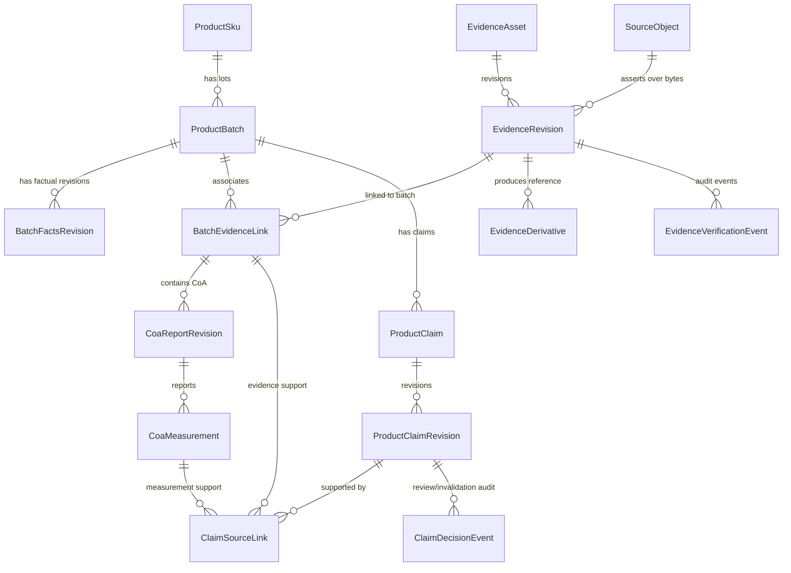
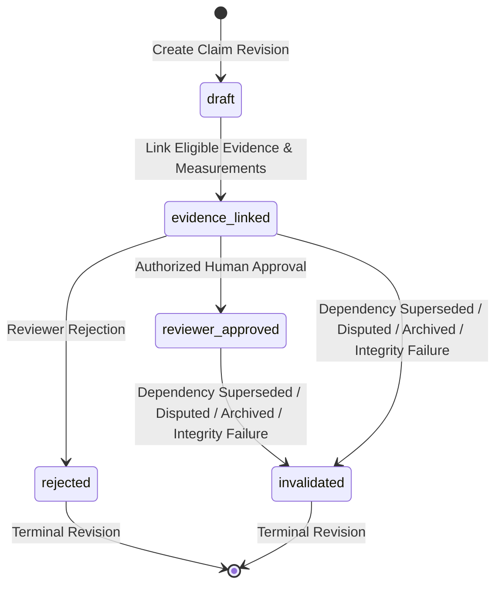

# 9. Verified Product, Batch, Evidence, and Claim Authority Architecture

Date: 2026-10-19

## Status

Accepted

> [!IMPORTANT]
> **Architectural Decision Scope Notice:**
> Status **Accepted** records architectural decision acceptance of the data contracts, relational constraints, state machines, and concurrency invariants specified herein for Phase 1 (*Verified batch and evidence records*). It does **not** assert implemented software support, human verification of any physical product, legal or regulatory approval, production deployment, or physical hardware certification.

Parent: #469 — Phase 1 (Verified batch and evidence records)  
Issue: #470 / VPM-P1.1 (Specify verified product, batch, evidence and claim authority contracts)

---

## Context

### 1. Grounded Codebase & Existing Architecture Baseline

In commercial generative video production, the platform generates compliant, high-fidelity marketing video assets conditioned on reference imagery and structured creative specifications (ADR 0001, ADR 0004, ADR 0005, ADR 0007). In regulated consumer goods industries (e.g., legal cannabis, botanical extracts, pharmaceuticals, and dietary supplements), brand campaigns require factual claims concerning product identity, batch-specific test results (potency, terpene profiles, absence of contaminants), geographic origin, cultivation methodology, and visual hero representation.

Prior to this decision, the codebase possessed media storage and reference conditioning mechanisms, but lacked a formal, tenant-isolated data model for verifiable product facts and auditable claims. An exhaustive audit of the grounded codebase establishes the following baseline facts and limitations:

1. **`ReferenceAsset` and Scene Bindings (`packages/domain/src/reference-asset.ts`):**
   - Represents an immutable media binary in object storage with client ID, storage bucket, storage key, SHA-256 digest, dimensions, MIME type, and optional `libraryRole` (`subject_identity`, `product`, `location`, `style`, `composition`).
   - *Current Reality:* In storage, `ReferenceAsset` is role-agnostic. `libraryRole` serves merely as an organizational default in the client's asset library, whereas `SceneReferenceBinding.role` carries visual conditioning authority for a specific scene revision.
   - *Limitation:* A `ReferenceAsset` carries no factual provenance: it does not record original raw capture masters, acquisition chain-of-custody, submitter assertions, rights/consent status, lot linkage, or independent verification.

2. **Reference Ingestion Pipeline (`packages/application/src/use-cases/upload-reference-asset.ts`):**
   - Implements hash-addressed upload to `clients/{clientId}/references/{sha256}`, verifying MIME types against image formats (JPEG, PNG, WebP), validating image dimensions, performing conditional object storage writes (`IfNoneMatch: "*"`), active row deduplication, and archived-row reactivation.
   - *Current Reality:* The existing-row shortcut returns the existing database record without re-reading or re-verifying bytes from object storage.
   - *Limitation:* This use case is strictly an image-conditioning ingestion pipeline. It cannot accept video masters, RAW camera files (DNG, ARW, CR3), documents (PDF), laboratory Certificates of Analysis (CoAs), or batch production logs. Furthermore, successful upload and byte hashing prove only byte consistency—they do not establish capture authenticity, submitter authority, or truth.

3. **Database Schema & Migrations (`001_baseline.sql`, `017_reference_assets_hardening.sql`, `022_reference_asset_content_hash_index.sql`):**
   - `reference_assets` is keyed on `asset_id UUID PRIMARY KEY`, with a foreign key to `clients(client_id) ON DELETE RESTRICT`, and `UNIQUE (storage_bucket, storage_object_key)`.
   - Migration `022_reference_asset_content_hash_index.sql` added `CREATE INDEX idx_reference_assets_content_hash ON reference_assets(content_hash_sha256)`—this is a **non-unique, global index**, not `UNIQUE (client_id, content_hash_sha256)`.
   - *Critical Schema Dependency:* The `reference_assets` table lacks a composite unique constraint on `(client_id, asset_id)`. To allow future composite foreign keys from evidence derivatives to enforce tenant boundaries mechanically at the database level, an additive candidate key `UNIQUE (client_id, asset_id)` must be scheduled on `reference_assets`.

4. **Global Query Helpers in Repositories (`PostgresReferenceAssetRepository`):**
   - Exposes `findByIdsGlobal` and global hash description helpers (`findDescriptionByContentHash`, `updateDescriptionByContentHash`) that query and update across tenant boundaries by hash alone.
   - *Architectural Rule:* Descriptions are mutable convenience metadata, not tenant-scoped factual assertions. The new evidence and claim contracts **must not** inherit these global access patterns or treat convenience descriptions as proof.

5. **Visual Authority vs. Factual Authority (ADR 0005, ADR 0007, `docs/prd.md`):**
   - ADR 0007 established that approved `SceneReferenceBindings` and the approved `ShotPlan` are the exclusive visual conditioning authority for generative video diffusion; previsualization stills (`PrevisCandidate`) are strictly non-authoritative director review evidence.
   - *Architectural Rule:* Product facts, laboratory test results, and marketing claims constitute an entirely distinct **Factual Authority Plane**. They do not introduce new ComfyUI nodes, do not alter MiniMax-H3 routing modes (`reference_directed` vs. `frame_anchored`), and do not inject unverified copy or cannabis attributes directly into diffusion prompts or `SceneSpec` geometry.

6. **Generation Manifests (`packages/contracts/src/generation-manifest.ts`):**
   - `GenerationManifest` captures immutable execution provenance of rendered frames (models, seeds, reference images, workflow hashes).
   - *Architectural Rule:* A generation manifest certifies what was executed by the diffusion worker; it does not certify that a product claim is true. Historical generation manifests remain immutable.

7. **Storage Retentions (`packages/shared/src/buckets.ts`, PRD §2.3):**
   - Ephemeral review and temp media expire after 14 to 60 days. Reference media is retained indefinitely while the client account remains active.
   - *Architectural Rule:* Neither ephemeral review TTLs nor general reference storage policies are sufficient for original source evidence. Original evidence requires an explicit, immutable archival class (`restricted_original`), tenant isolation, and strict governance review before production deployment.

### 2. Problem Statement

Without a rigorous, normalized, and immutable factual data model:
- Marketing claims risk being published without verifiable supporting laboratory reports or cultivation records.
- Numerical claims (e.g., "24.5% THC") could be entered as arbitrary strings without unit types, measurement limits, or testing context.
- Laboratory reports covering a single sample could be conflated with whole-lot representations.
- Superseded or disputed laboratory reports would leave approved marketing claims active indefinitely, creating severe regulatory exposure.
- Reference assets could be reused across different batches or clients without cryptographic or lot-level provenance.

### 3. Non-Goals

The following areas are explicitly out of scope for this architecture:
- Authoring or hard-coding a jurisdiction-specific regulatory rule engine (e.g., Canadian Cannabis Act or California DCC packaging regulations).
- Automated marketing-copy generation, caption authoring, or visual ad generation.
- Optical Character Recognition (OCR) or Large Language Model (LLM) interpretation/extraction of uploaded CoA PDF documents.
- "AI-certified truth" or automated automated claim approval without human attestation.
- Adding product, batch, or cannabis-specific fields to `SceneSpec`, `ShotPlan`, or `GenerationManifest`.
- Execution of physical laboratory testing or render host model certification.

---

## Decision

We establish the foundational architecture for verified products, batches, evidence, and claim authority:

> **"Product facts and commercial claims constitute an independent, authoritative verification plane distinct from visual generation conditioning. Visual diffusion conditioning remains strictly governed by SceneReferenceBindings and ShotPlans (ADR 0007); product claims and batch evidence are never inferred by AI, never mutable in-place without revision fencing, and automatically fail-closed upon source supersession, dispute, or integrity mismatch."**

---

### 1. Five Distinct Authority Planes

To eliminate ambiguity across the lifecycle, the platform formally separates five distinct authority dimensions:

| Authority Plane | Governing Contract | Authority Holder | Meaning & Guarantees |
| :--- | :--- | :--- | :--- |
| **Byte Integrity** | `SourceObject` | Cryptographic SHA-256 Digest | Proves exact bitwise preservation of an ingested file. Proves **nothing** regarding capture context, author, or truth. |
| **Submitter Assertion** | `EvidenceRevision`, `BatchFactsRevision` | Submitter / Client Operator | Records what an authenticated actor claims to have captured, received, or produced. |
| **Independent Verification** | `EvidenceVerificationEvent` | Third-Party Lab / Independent Auditor | Records formal external corroboration (e.g., accredited lab identity, chain of custody audit). |
| **Factual Claim Authority** | `ProductClaimRevision`, `ClaimHead` | Authorized Compliance Reviewer | Revision-fenced legal/compliance sign-off confirming a claim is supported by active, eligible evidence. |
| **Visual Conditioning Authority** | `ShotPlan`, `SceneReferenceBinding` (ADR 0007) | Creative Director | Controls camera, beats, and reference image conditioning into generative diffusion pipelines. |

---

### 2. Core Entities, Boundaries, and Identities

All entities are strictly tenant-scoped (`clientId`). Identifiers are server-generated UUIDs (UUIDv7 preferred for chronological sorting).



#### 2.1 ProductSku
- **Identity:** `skuId` (UUID, server-assigned).
- **Canonical Identifier:** `canonicalSku` (trimmed uppercase alphanumeric string matching `^[A-Z0-9_-]{3,64}$`).
- **Uniqueness:** Permanently unique per tenant via `UNIQUE (client_id, canonical_sku)`. Archiving a SKU does not release the canonical SKU name.
- **Immutability:** `canonicalSku` is immutable once created. A rename or code change requires provisioning a new `skuId`.

#### 2.2 ProductBatch
- **Identity:** `batchId` (UUID, server-assigned).
- **Lot Identifier:** `lotIdentifier` (trimmed case-sensitive string matching `^[A-Za-z0-9_.-]{1,128}$`).
- **Parent SKU:** Bound to `skuId` of the same client.
- **Uniqueness:** Permanently unique per client and SKU via `UNIQUE (client_id, sku_id, lot_identifier)`. Archiving a batch does not release the lot identifier.
- **Head & Facts Separation:** Mutable batch attributes (display name, archive status) reside on the `product_batches` head table under optimistic concurrency control (`version`). Factual batch attributes (origin, harvest dates, cultivation method) reside in append-only `product_batch_facts` revisions.

#### 2.3 SourceObject
- **Identity:** `sourceObjectId` (UUID, server-assigned).
- **Byte Addressability:** Cryptographic lowercase 64-hex SHA-256 digest (`originalSha256`).
- **Tenant Isolation:** Deduplication is strictly client-scoped via `UNIQUE (client_id, original_sha256)`. Identical files uploaded by two distinct tenants produce two distinct `source_objects` and distinct storage keys. No cross-tenant metadata or existence leakage is permitted.
- **Storage Contract:**
  - Storage key: `clients/{clientId}/evidence/originals/{sha256}`.
  - Access class: `restricted_original`.
  - Retention class: `source_evidence_archive`.
  - Retention policy version: Explicit version token (e.g., `v1-legal-hold`).
  - Availability state: `available`, `archived`, `quarantined`, `deleted_under_retention`.

#### 2.4 EvidenceAsset and EvidenceRevision
- **Separation of Object and Assertion:** `SourceObject` represents the physical file bytes. `EvidenceRevision` represents an authenticated, revision-fenced assertion about those bytes.
- **Multiple Assertions:** If the exact same file is uploaded twice by the same client with different asserted metadata, the system reuses the existing `SourceObject` but records a distinct, traceable `EvidenceRevision`.
- **Source Classes:**
  - `photo`: Finished product photos, packaging photos, macro flower shots.
  - `video`: B-roll, facility tours, harvest footage.
  - `raw`: High-resolution camera raw masters (DNG, ARW, CR3, ProRes).
  - `document`: General provenance documents, standard operating procedures, organic certifications.
  - `coa`: Accredited laboratory Certificate of Analysis test reports.
  - `process_record`: Cultivation logs, batch extraction logs, chain of custody transfer manifests.
- **Acquisition & Rights:** Every revision explicitly records `acquisitionMethod`, `submittedBy`, `submittedAt`, `assertionText`, `reportedCaptureDate` (optional date-only string with precision context), `rightsStatus`, and `consentStatus`.
- **Controlled Rights & Consent:** Values are strictly `unknown`, `granted`, `restricted`, or `denied`. An `unknown` state explicitly does **not** grant commercial usage permission.

#### 2.5 BatchEvidenceLink
- **Explicit Association:** Connects an exact `(evidenceId, evidenceRevision)` to a `(batchId)`.
- **No Implicit Inheritance:** A batch does **not** inherit evidence from parent SKUs, sibling lots, or past harvests. Every piece of supporting evidence must be explicitly linked with a declared `purpose`:
  - `macro_hero_photo`
  - `coa_test_report`
  - `cultivation_log`
  - `processing_record`
  - `packaging_spec`
  - `general_supporting_evidence`

#### 2.6 EvidenceDerivative (Bridge to ReferenceAsset)
- **Bridge to Visual Conditioning:** Connects an `EvidenceRevision` to a generative visual conditioning `ReferenceAsset` (`packages/domain/src/reference-asset.ts`).
- **Lineage Integrity:** An existing `ReferenceAsset` may be linked as a derivative only after establishing an original `SourceObject` and its `EvidenceRevision`.
- **Hash Independence:** The derivative has its own distinct content hash (`derivativeSha256`), dimensions, and WebP/PNG MIME type. It never inherits the RAW/master's hash.
- **Derivative Verification:** Linking verifies that the target `ReferenceAsset` exists, belongs to the same client, is unarchived, and matches `derivativeSha256`.

#### 2.7 CoaReportRevision and CoaMeasurement
- **Report Scope (`scopeKind`):**
  - `sample_only`: The test results represent solely the specific physical sample submitted to the testing facility.
  - `attributed_lot`: The test results are attributed to the entire batch under a documented, verified composite sampling protocol.
- **Claimed vs. Verified Lab Identity:**
  - `labNameAsClaimed`: Name of the laboratory reported on the document.
  - `verifiedLabIdentityEventId`: Optional foreign key to an `EvidenceVerificationEvent` corroborating accredited laboratory identity and accreditation license. The referenced verification event must belong to the same client, evidence asset, and evidence revision (`outcome = 'verified'`, `fact_scope = 'lab_identity'`, `verification_kind = 'independent_third_party_corroboration'`).
- **Strict Decimal Representations (`CoaMeasurement`):**
  - All numerical measurements are stored as **exact decimal strings** conforming to `^-?(0|[1-9][0-9]*)(\.[0-9]+)?$`. Floating-point numbers (`NUMERIC` in SQL, `string` in TypeScript; never IEEE 754 `number`) are mandatory to eliminate rounding and scale loss.
  - **Typed Result Union:**
    - `quantified`: Exact measured value (`value: DecimalString`).
    - `below_limit`: Below limit of quantification (`limit: DecimalString`, `qualifier: "lt" | "lte"`).
    - `not_detected`: Analyte was not detected by the analytical instrument.
  - **Mandatory Units & Context:** Every measurement row requires non-empty strings for `analyte` (e.g., `thc_total`, `myrcene`), `unit` (e.g., `percent_w_w`, `mg_per_g`, `ppm`), `basis` (e.g., `dry_weight`, `as_received`), and `context` (e.g., `finished_inflorescence`, `extract`). Ambiguous or unitless measurements fail closed.
  - **Lineage Integrity:** Measurements inherit and mechanically enforce the exact `(batch_id, evidence_id, evidence_revision)` of their parent `CoaReportRevision`.

#### 2.8 ProductClaimRevision and ClaimSourceLink
- **Claim Types:**
  - `potency_cannabinoid`: Total THC, CBD, CBG, active cannabinoids.
  - `terpene_profile`: Dominant terpenes, total terpene percentage, aroma profile.
  - `origin_geography`: Appellation, region, indoor/outdoor facility location.
  - `cultivation_process`: Living soil, organic inputs, pesticide-free, hand-trimmed, sun-grown.
  - `sensory_visual`: Bud structure, trichome coverage, color description.
  - `clean_test_absence`: Tested below quantification limit or non-detected for pesticides, heavy metals, residual solvents, or microbials. Mandatory analytical context and detection limits must be preserved; neither `below_limit` nor `not_detected` may ever be converted into numerical zero ("0", "0.0%"), "Zero", or an exact numerical marketing value. Claims must state analytical limits in context (e.g., "Not detected at or above analytical detection limit of 0.01 ppm per Method EPA-8270D"). Any claim asserting absolute zero, "0%", or unqualified absence fails policy validation and is rejected.
- **Proof Categories:**
  - `coa_measurement_backed`: Backed by one or more exact `CoaMeasurement` rows from an active, active-lot CoA report.
  - `production_record_backed`: Backed by operational cultivation/processing records and verified batch facts.
  - `visual_evidence_backed`: Backed by macro photography or video evidence linked to the batch.
  - `human_attested_unverified`: Commercial copy asserted solely by human attestation without independent laboratory or operational evidence.
- **Numerical Claims:**
  - A numerical claim requires paired typed values: `numericalValue: DecimalString` and `numericalUnit: string`.
  - The numerical value and unit must exactly match the cited `CoaMeasurement`.
  - Free-text marketing copy containing numerical values (e.g., "Contains 28% THC") cannot bypass policy by claiming to be `human_attested_unverified`. Later slices must enforce typed claim-authoring boundaries.
- **ClaimSourceLink & Multi-Measurement Support:**
  - Connects a claim revision to supporting evidence links and measurements.
  - Mechanically enforces tenant and batch boundaries via composite foreign keys: a claim on Batch A can only link evidence and measurements belonging to Batch A.
  - Supported by a surrogate `linkId` and composite uniqueness over `(client_id, claim_id, claim_revision, evidence_id, evidence_revision, measurement_id)` using `UNIQUE NULLS NOT DISTINCT` (or a PostgreSQL expression index coalescing `measurement_id`), allowing multiple measurements from the same CoA report revision (e.g. multi-analyte terpene profiles or cannabinoid suites) to back a single claim revision, while deduplicating non-measurement evidence (where `measurement_id IS NULL`).

---

### 3. Claim Lifecycle, Concurrency & Invalidation

#### 3.1 Claim State Machine

Claims follow a deterministic, fail-closed state machine. Revisions are immutable. State transitions are governed by optimistic version fencing on the claim head (`product_claims.version`).



1. **`draft`:** Initial authoring state. Copy, claim type, and proposed numerical values are drafted.
2. **`evidence_linked`:** Client links valid, same-batch evidence and measurement rows satisfying the claim-type policy matrix.
3. **`reviewer_approved`:** An authorized compliance reviewer reviews the linked evidence and issues a formal approval event.
4. **`rejected`:** A reviewer rejects the claim revision. **Terminal state** for that revision.
5. **`invalidated`:** An approved or evidence-linked claim revision is automatically invalidated when an underlying dependency fails eligibility. **Terminal state** for that revision.

#### 3.2 Invalidation Causes
An active claim revision is deterministically transitioned to `invalidated` upon any of the following triggers:
- `source_superseded`: An underlying `EvidenceRevision`, `CoaReportRevision`, or `BatchFactsRevision` is superseded by a newer revision.
- `source_disputed`: An underlying laboratory report or evidence asset receives a dispute verification event (`REPORT_DISPUTED`).
- `source_archived`: An underlying `ReferenceAsset`, `EvidenceAsset`, or `ProductBatch` is archived.
- `source_quarantined`: An underlying `SourceObject` is quarantined due to legal hold, malicious payload, or privacy withdrawal.
- `integrity_failure`: An underlying `SourceObject` fails byte digest verification against persistent object storage (`SOURCE_INTEGRITY_MISMATCH`).
- `batch_facts_changed`: Essential batch facts (e.g., origin producer, cultivation method) are updated.

#### 3.3 Atomic Supersession & Invalidation Semantics
Superseding an evidence revision or CoA report revision executes under strict transactional atomicity:
1. Begins a database transaction and acquires pessimistic row locks in deterministic order.
2. Appends the new revision row to the database (e.g., `coa_report_revisions` rev 2 and new `coa_measurements`).
3. Advances the head pointer on the parent entity under an `expectedVersion` check (e.g., `UPDATE coa_reports SET current_revision = 2, version = version + 1 WHERE report_id = $id AND version = $expectedVersion`).
4. Queries all active claim revisions dependent on the superseded revision.
5. Appends a `ClaimDecisionEvent` for each affected claim with `decision = "invalidate"`, recording the supersession event ID and cause (`source_superseded`).
6. Updates all affected claim heads to `state = "invalidated"` and increments `version = version + 1`.
7. Inserts an idempotent command receipt into `product_evidence_command_receipts` capturing `action_id`, `payload_sha256`, actor, and response payload.
8. Commits the transaction atomically. No state mutation or invalidation is committed without its corresponding receipt.

#### 3.4 Concurrency Serialization & Commit Order Walkthrough
To guarantee zero deadlocks and prevent orphaned approvals during concurrent approval and supersession, row-level locks (`SELECT ... FOR UPDATE`) are acquired in strict hierarchical order:
1. `product_batches (client_id, batch_id)`
2. `evidence_assets (client_id, evidence_id)`
3. `coa_reports (client_id, report_id)`
4. `product_claims (client_id, claim_id)`

Both execution orders serialize cleanly and fail closed:

- **Walk Order A (Supersede commits first):**
  - **Tx 1 (Supersede):** Locks report and dependent claims, appends new report revision, updates report head, records claim invalidations, updates claim heads to `invalidated`, inserts command receipt, and commits.
  - **Tx 2 (Approve):** Concurrently attempts to approve the claim. Upon acquiring the locks, Tx 2 executes its mandatory pre-commit dependency recheck: it inspects the current revision of the CoA report and finds it has advanced past the revision cited in the claim's source links (or finds `product_claims.state = 'invalidated'`). Tx 2 detects the superseded dependency, rolls back immediately with zero writes, and returns HTTP 409 `SOURCE_SUPERSEDED`.
- **Walk Order B (Approve commits first):**
  - **Tx 1 (Approve):** Locks claim and dependencies, validates that all dependencies are current and eligible, updates claim head to `reviewer_approved`, appends approval `ClaimDecisionEvent`, inserts command receipt, and commits.
  - **Tx 2 (Supersede):** Concurrently attempts to supersede the report. Upon acquiring locks, Tx 2 appends the new report revision, updates report head, inspects dependent claims (now finding the newly approved claim), appends a `ClaimDecisionEvent` (`decision = "invalidate"`, `invalidation_cause = "source_superseded"`), updates the claim head to `invalidated`, inserts command receipt, and commits.
  - **Result:** In both commit orders, committed state is deterministic, no invalid or superseded claim remains approved, and no deadlock can occur.

#### 3.5 Idempotent Command Processing & Receipt-First Replay Recipe
Clients submit every mutating command with a server-validated UUIDv7 `actionId`. The application executes the following idempotent execution recipe:
1. Query `product_evidence_command_receipts` for `(client_id, action_id)`.
2. **If receipt exists:**
   - Compute SHA-256 of canonical JSON (lexicographically sorted keys, no whitespace) of the incoming command payload.
   - If `payload_sha256 == computed_hash`, return the stored `response_body` (idempotent replay, HTTP 200, zero database writes).
   - If `payload_sha256 != computed_hash`, abort immediately with HTTP 409 `IDEMPOTENCY_CONFLICT` (zero writes).
3. **If no receipt exists:**
   - Execute version-fenced mutation under deterministic row locks.
   - Insert receipt `(client_id, action_id, command_name, payload_sha256, actor_id, response_body, committed_at)` in the same transaction.
   - Commit transaction atomically.

---

### 4. Storage Architecture, Security & Governance

#### 4.1 Tenant-Scoped Storage Layout
Original source files and visual derivatives are stored in separate logical namespaces:
- **Original Source Evidence:**
  - Key format: `clients/{clientId}/evidence/originals/{sha256}`
  - Access class: `restricted_original`
  - Permissions: Read access restricted to authorized compliance roles; write access requires cryptographic collision checks; delete access forbidden under standard application roles.
- **Visual Derivatives & Previews:**
  - Key format: `clients/{clientId}/references/{sha256}`
  - Storage bucket: `BUCKETS.REFERENCE`
  - Access class: Platform reference media delivery.

#### 4.2 Ingest Verification, Collision Integrity & Quota Rules
1. **On Ingest:** Ingesting a source object streams bytes directly through a SHA-256 stream hasher to compute the exact bitwise digest. The MIME type is detected directly from byte headers (magic numbers / libmagic); if the detected MIME type conflicts with the declared type, ingest fails closed (`MIME_CONFLICT`). The object is committed to object storage using `IfNoneMatch: "*"` (put-if-absent).
2. **On Collision:** If an object already exists at `clients/{clientId}/evidence/originals/{sha256}`:
   - The storage adapter performs exact-byte SHA-256 verification (or byte-for-byte stream comparison) of the existing persisted object. Object-storage ETags are strictly excluded as SHA-256 substitutes (S3 multipart ETags are MD5 sums of chunk checksums, not SHA-256 digests).
   - Verify that `detectedMimeType`, `byteLength`, and integrity parameters match the existing `source_objects` record.
   - If stored bytes do not match SHA-256 or if metadata conflicts with the incoming payload (e.g. differing detected MIME type or length), the operation fails closed with `SOURCE_INTEGRITY_MISMATCH` or `MIME_CONFLICT`, rejecting the ingest.
   - If bytes and metadata match identically, the existing `source_objects` record is reused without duplicate storage writes.
3. **Tamper Detection:** Prior to using an original evidence asset in any verification, derivative linking, or claim approval operation, the infrastructure adapter validates the stored object's exact-byte SHA-256 against `source_objects.original_sha256`. Any discrepancy aborts with `SOURCE_INTEGRITY_MISMATCH`, marks `source_objects.availability = 'quarantined'`, and triggers immediate fail-closed invalidation of all dependent claims.
4. **Atomic Quota Reservations & Deduplication Accounting:**
   - Before streaming or accepting incoming uploads, the application reserves quota via `reserveStorageQuota` across three dimensions: per-source-class max bytes (e.g. photo 50MB, RAW/video 500MB, document 25MB), per-client total stored bytes, and concurrent upload limits.
   - In the absence of an explicit, validated quota and retention configuration, storage operations fail closed (`QUOTA_EXCEEDED` or `ACCESS_DENIED`).
   - If an upload dedupes against an existing committed `SourceObject`, the reservation is released and no additional storage bytes are charged to the client's quota.
5. **Ownership-Aware Cleanup Semantics:**
   - If an upload fails, errors, or aborts during streaming or verification, cleanup deletes **only** the uncommitted staging object created for that specific ingest attempt.
   - Cleanup **never** deletes or mutates shared committed `SourceObject`s referenced by existing database records.

#### 4.3 Governance & Production Storage Readiness Gate

> [!CAUTION]
> **Production Storage Governance Boundary:**
> 1. Ingestion of raw original evidence objects into production object storage **must remain disabled** until an independent security, legal, and privacy review formally establishes:
>    - Production retention schedules (e.g., minimum 7-year regulatory hold for cannabis batch testing records).
>    - Deletion and right-to-be-forgotten / legal-hold override procedures.
>    - Client storage byte quotas, per-file upload size limits, and concurrent upload throttling.
> 2. In the absence of an explicit, validated quota and retention configuration, the storage adapter **must fail closed** (`QUOTA_EXCEEDED` or `ACCESS_DENIED`).
> 3. Original source files (PDFs, high-res photos) must **never** be transmitted to external cloud LLM or OCR providers without an explicit, audit-logged client policy grant (`external_processing_policy.allowCloudEvidenceProcessing = true`).

---

### 5. Schema-Level TypeScript Contracts

The following TypeScript definitions represent the authoritative data contracts for domain entities, value objects, commands, and template pins.

```typescript
// ============================================================================
// Brand Types & Lexical Grammars
// ============================================================================

export type Brand<K, T> = K & { readonly __brand: T };

export type ClientId = Brand<string, "ClientId">;
export type SkuId = Brand<string, "SkuId">;
export type BatchId = Brand<string, "BatchId">;
export type SourceObjectId = Brand<string, "SourceObjectId">;
export type EvidenceId = Brand<string, "EvidenceId">;
export type DerivativeId = Brand<string, "DerivativeId">;
export type VerificationEventId = Brand<string, "VerificationEventId">;
export type CoaReportId = Brand<string, "CoaReportId">;
export type CoaMeasurementId = Brand<string, "CoaMeasurementId">;
export type ClaimId = Brand<string, "ClaimId">;
export type ClaimEventId = Brand<string, "ClaimEventId">;
export type ActionId = Brand<string, "ActionId">;

/** Lowercase 64-hex SHA-256 digest string */
export type Sha256Hex = string & { readonly __sha256: true };

/** Exact decimal representation string conforming to: ^-?(0|[1-9][0-9]*)(\.[0-9]+)?$ */
export type DecimalString = string & { readonly __decimal: true };

/** ISO 8601 UTC timestamp string: YYYY-MM-DDTHH:mm:ss.sssZ */
export type IsoTimestampString = string;

/** Date-only string: YYYY-MM-DD */
export type DateOnlyString = string;

// ============================================================================
// Enums & Controlled Vocabularies
// ============================================================================

export type EvidenceSourceClass =
  | "photo"
  | "video"
  | "raw"
  | "document"
  | "coa"
  | "process_record";

export type EvidenceAcquisitionMethod =
  | "direct_upload"
  | "supplier_submission"
  | "field_capture"
  | "lab_transfer";

export type LegalRightsStatus = "unknown" | "granted" | "restricted" | "denied";
export type ConsentStatus = "unknown" | "granted" | "restricted" | "denied";

export type BatchEvidencePurpose =
  | "macro_hero_photo"
  | "coa_test_report"
  | "cultivation_log"
  | "processing_record"
  | "packaging_spec"
  | "general_supporting_evidence";

export type VerificationOutcome = "verified" | "rejected" | "disputed" | "withdrawn";

export type VerificationKind =
  | "submitter_attestation"
  | "human_internal_review"
  | "independent_third_party_corroboration";

export type VerificationFactScope =
  | "provenance_metadata"
  | "capture_circumstances"
  | "lab_identity"
  | "chain_of_custody"
  | "full_document_authenticity";

export type BatchOriginKind = "own_production" | "partner_origin" | "unknown";

export type CoaScopeKind = "sample_only" | "attributed_lot";

export type ProductClaimType =
  | "potency_cannabinoid"
  | "terpene_profile"
  | "origin_geography"
  | "cultivation_process"
  | "sensory_visual"
  | "clean_test_absence";

export type ClaimProofCategory =
  | "coa_measurement_backed"
  | "production_record_backed"
  | "visual_evidence_backed"
  | "human_attested_unverified";

export type ClaimState =
  | "draft"
  | "evidence_linked"
  | "reviewer_approved"
  | "rejected"
  | "invalidated";

export type ClaimInvalidationCause =
  | "source_superseded"
  | "source_disputed"
  | "source_archived"
  | "source_quarantined"
  | "integrity_failure"
  | "batch_facts_changed";

export type ClaimSupportRole =
  | "primary_measurement"
  | "corroborating_record"
  | "visual_reference";

// ============================================================================
// Core Entities & Revisions
// ============================================================================

export interface ProductSku {
  readonly clientId: ClientId;
  readonly skuId: SkuId;
  readonly canonicalSku: string;
  readonly displayName: string;
  readonly version: number;
  readonly createdAt: IsoTimestampString;
  readonly updatedAt: IsoTimestampString;
  readonly archivedAt: IsoTimestampString | null;
}

export interface ProductBatch {
  readonly clientId: ClientId;
  readonly batchId: BatchId;
  readonly skuId: SkuId;
  readonly lotIdentifier: string;
  readonly version: number;
  readonly currentFactsRevision: number;
  readonly displayName: string;
  readonly createdAt: IsoTimestampString;
  readonly updatedAt: IsoTimestampString;
  readonly archivedAt: IsoTimestampString | null;
}

export interface BatchFactsRevision {
  readonly clientId: ClientId;
  readonly batchId: BatchId;
  readonly revision: number;
  readonly originKind: BatchOriginKind;
  readonly producerIdentityAsClaimed: string | null;
  readonly productionStartDate: DateOnlyString | null;
  readonly productionEndDate: DateOnlyString | null;
  readonly originEvidenceId: EvidenceId | null;
  readonly originEvidenceRevision: number | null;
  readonly assertedBy: string;
  readonly assertedAt: IsoTimestampString;
  readonly supersedesRevision: number | null;
}

export interface SourceObject {
  readonly clientId: ClientId;
  readonly sourceObjectId: SourceObjectId;
  readonly storageBucket: string;
  readonly storageObjectKey: string;
  readonly originalSha256: Sha256Hex;
  readonly detectedMimeType: string;
  readonly byteLength: number;
  readonly uploadedAt: IsoTimestampString;
  readonly uploaderId: string;
  readonly accessClass: "restricted_original";
  readonly retentionClass: "source_evidence_archive";
  readonly retentionPolicyVersion: string;
  readonly availability: "available" | "archived" | "quarantined" | "deleted_under_retention";
  readonly storageVersionId: string | null;
}

export interface EvidenceAsset {
  readonly clientId: ClientId;
  readonly evidenceId: EvidenceId;
  readonly currentRevision: number;
  readonly version: number;
  readonly createdAt: IsoTimestampString;
  readonly archivedAt: IsoTimestampString | null;
}

export interface EvidenceRevision {
  readonly clientId: ClientId;
  readonly evidenceId: EvidenceId;
  readonly revision: number;
  readonly sourceObjectId: SourceObjectId;
  readonly sourceClass: EvidenceSourceClass;
  readonly acquisitionMethod: EvidenceAcquisitionMethod;
  readonly submittedBy: string;
  readonly submittedAt: IsoTimestampString;
  readonly assertionText: string;
  readonly reportedCaptureDate: DateOnlyString | null;
  readonly captureContext: string | null;
  readonly rightsStatus: LegalRightsStatus;
  readonly consentStatus: ConsentStatus;
  readonly rightsAttribution: string | null;
  readonly rightsDocumentLocator: string | null;
  readonly supersedesRevision: number | null;
}

export interface BatchEvidenceLink {
  readonly clientId: ClientId;
  readonly batchId: BatchId;
  readonly evidenceId: EvidenceId;
  readonly evidenceRevision: number;
  readonly purpose: BatchEvidencePurpose;
  readonly assertedBy: string;
  readonly assertedAt: IsoTimestampString;
}

export interface EvidenceDerivative {
  readonly clientId: ClientId;
  readonly derivativeId: DerivativeId;
  readonly evidenceId: EvidenceId;
  readonly evidenceRevision: number;
  readonly referenceAssetId: string; // References reference_assets(asset_id)
  readonly derivativeSha256: Sha256Hex;
  readonly transformDescription: string;
  readonly transformToolVersion: string | null;
  readonly createdBy: string;
  readonly createdAt: IsoTimestampString;
}

export interface EvidenceVerificationEvent {
  readonly clientId: ClientId;
  readonly eventId: VerificationEventId;
  readonly evidenceId: EvidenceId;
  readonly evidenceRevision: number;
  readonly outcome: VerificationOutcome;
  readonly verificationKind: VerificationKind;
  readonly factScope: VerificationFactScope;
  readonly actorId: string;
  readonly occurredAt: IsoTimestampString;
  readonly method: string;
  readonly reason: string;
  readonly verifiedPartyReference: string | null;
  readonly withdrawalEventId: VerificationEventId | null;
}

export interface CoaReport {
  readonly clientId: ClientId;
  readonly reportId: CoaReportId;
  readonly currentRevision: number;
  readonly version: number;
  readonly createdAt: IsoTimestampString;
  readonly archivedAt: IsoTimestampString | null;
}

export interface CoaReportRevision {
  readonly clientId: ClientId;
  readonly reportId: CoaReportId;
  readonly revision: number;
  readonly batchId: BatchId;
  readonly evidenceId: EvidenceId;
  readonly evidenceRevision: number;
  readonly reportIdentifierAsClaimed: string;
  readonly reportDate: DateOnlyString;
  readonly labNameAsClaimed: string;
  readonly sampleIdentifierAsClaimed: string;
  readonly scopeKind: CoaScopeKind;
  readonly scopeDescription: string;
  readonly sampleDate: DateOnlyString | null;
  readonly samplingMethodDescription: string | null;
  readonly verifiedLabIdentityEventId: VerificationEventId | null;
  readonly assertedBy: string;
  readonly assertedAt: IsoTimestampString;
  readonly supersedesRevision: number | null;
}

export type CoaMeasurementResult =
  | { readonly kind: "quantified"; readonly value: DecimalString }
  | { readonly kind: "below_limit"; readonly limit: DecimalString; readonly qualifier: "lt" | "lte" }
  | { readonly kind: "not_detected" };

export interface CoaMeasurement {
  readonly clientId: ClientId;
  readonly measurementId: CoaMeasurementId;
  readonly reportId: CoaReportId;
  readonly reportRevision: number;
  readonly batchId: BatchId;
  readonly evidenceId: EvidenceId;
  readonly evidenceRevision: number;
  readonly analyte: string;
  readonly result: CoaMeasurementResult;
  readonly unit: string;
  readonly basis: string;
  readonly context: string;
  readonly methodAsReported: string;
}

export interface ProductClaim {
  readonly clientId: ClientId;
  readonly claimId: ClaimId;
  readonly batchId: BatchId;
  readonly currentRevision: number;
  readonly state: ClaimState;
  readonly version: number;
  readonly updatedAt: IsoTimestampString;
  readonly invalidationCause: ClaimInvalidationCause | null;
  readonly invalidationSourceEventId: string | null;
}

export type ProductClaimRevision =
  | {
      readonly clientId: ClientId;
      readonly claimId: ClaimId;
      readonly revision: number;
      readonly batchId: BatchId;
      readonly claimType: ProductClaimType;
      readonly wording: string;
      readonly proofCategory: "coa_measurement_backed";
      readonly hasNumericalSupport: true;
      readonly numericalValue: DecimalString;
      readonly numericalUnit: string;
      readonly createdBy: string;
      readonly createdAt: IsoTimestampString;
      readonly policyVersion: string;
      readonly supersedesRevision: number | null;
    }
  | {
      readonly clientId: ClientId;
      readonly claimId: ClaimId;
      readonly revision: number;
      readonly batchId: BatchId;
      readonly claimType: ProductClaimType;
      readonly wording: string;
      readonly proofCategory: ClaimProofCategory;
      readonly hasNumericalSupport: false;
      readonly numericalValue: null;
      readonly numericalUnit: null;
      readonly createdBy: string;
      readonly createdAt: IsoTimestampString;
      readonly policyVersion: string;
      readonly supersedesRevision: number | null;
    };


export type ClaimSourceLinkId = Brand<string, "ClaimSourceLinkId">;

export type ClaimSourceLink =
  | {
      readonly clientId: ClientId;
      readonly linkId: ClaimSourceLinkId;
      readonly claimId: ClaimId;
      readonly claimRevision: number;
      readonly batchId: BatchId;
      readonly evidenceId: EvidenceId;
      readonly evidenceRevision: number;
      readonly supportRole: "primary_measurement";
      readonly linkKind: "measurement_backed";
      readonly reportId: CoaReportId;
      readonly reportRevision: number;
      readonly measurementId: CoaMeasurementId;
    }
  | {
      readonly clientId: ClientId;
      readonly linkId: ClaimSourceLinkId;
      readonly claimId: ClaimId;
      readonly claimRevision: number;
      readonly batchId: BatchId;
      readonly evidenceId: EvidenceId;
      readonly evidenceRevision: number;
      readonly supportRole: Exclude<ClaimSupportRole, "primary_measurement">;
      readonly linkKind: "evidence_only";
      readonly reportId: null;
      readonly reportRevision: null;
      readonly measurementId: null;
    };

export interface ClaimDecisionEvent {
  readonly clientId: ClientId;
  readonly eventId: ClaimEventId;
  readonly claimId: ClaimId;
  readonly claimRevision: number;
  readonly decision: "link_evidence" | "approve" | "reject" | "invalidate";
  readonly actorId: string;
  readonly occurredAt: IsoTimestampString;
  readonly reason: string;
  readonly invalidationCause: ClaimInvalidationCause | null;
  readonly sourceEventId: string | null;
}

// ============================================================================
// Template Pinning Contract (Bridge to Downstream Video Generation)
// ============================================================================

export interface PinnedEvidenceReference {
  readonly evidenceId: EvidenceId;
  readonly evidenceRevision: number;
  readonly originalSha256: Sha256Hex;
  readonly derivativeId: DerivativeId;
  readonly referenceAssetId: string;
}

export interface PinnedClaimReference {
  readonly claimId: ClaimId;
  readonly claimRevision: number;
  readonly approvalEventId: ClaimEventId;
}

export interface PinnedProductBatchResolution {
  readonly clientId: ClientId;
  readonly batchId: BatchId;
  readonly batchFactsRevision: number;
  readonly evidence: readonly PinnedEvidenceReference[];
  readonly claims: readonly PinnedClaimReference[];
}
```

---

### 6. Normalized PostgreSQL Schema & Constraint Map

The following relational schema specifies the exact tables, column types, constraints, and relational dependencies required for Phase 1.

```sql
-- ---------------------------------------------------------------------------
-- PRE-REQUISITE SCHEMA ADJUSTMENT:
-- Reference Assets must support composite foreign keys for tenant boundary enforcement.
-- ---------------------------------------------------------------------------

ALTER TABLE reference_assets
  ADD CONSTRAINT uq_reference_assets_client_asset UNIQUE (client_id, asset_id);

-- ---------------------------------------------------------------------------
-- 1. PRODUCT SKUS
-- ---------------------------------------------------------------------------

CREATE TABLE product_skus (
  sku_id UUID PRIMARY KEY DEFAULT gen_random_uuid(),
  client_id UUID NOT NULL REFERENCES clients(client_id) ON DELETE RESTRICT,
  canonical_sku VARCHAR(64) NOT NULL,
  display_name VARCHAR(255) NOT NULL,
  version INT NOT NULL DEFAULT 1 CHECK (version > 0),
  created_at TIMESTAMPTZ NOT NULL DEFAULT CURRENT_TIMESTAMP,
  updated_at TIMESTAMPTZ NOT NULL DEFAULT CURRENT_TIMESTAMP,
  archived_at TIMESTAMPTZ,
  CONSTRAINT uq_product_skus_client_sku UNIQUE (client_id, sku_id),
  CONSTRAINT uq_product_skus_canonical UNIQUE (client_id, canonical_sku),
  CONSTRAINT chk_canonical_sku_format CHECK (canonical_sku ~ '^[A-Z0-9_-]{3,64}$')
);

CREATE INDEX idx_product_skus_client_active
  ON product_skus(client_id)
  WHERE archived_at IS NULL;

-- ---------------------------------------------------------------------------
-- 2. PRODUCT BATCHES & FACTS
-- ---------------------------------------------------------------------------

CREATE TABLE product_batches (
  batch_id UUID PRIMARY KEY DEFAULT gen_random_uuid(),
  client_id UUID NOT NULL,
  sku_id UUID NOT NULL,
  lot_identifier VARCHAR(128) NOT NULL,
  display_name VARCHAR(255) NOT NULL,
  version INT NOT NULL DEFAULT 1 CHECK (version > 0),
  current_facts_revision INT NOT NULL DEFAULT 1 CHECK (current_facts_revision > 0),
  created_at TIMESTAMPTZ NOT NULL DEFAULT CURRENT_TIMESTAMP,
  updated_at TIMESTAMPTZ NOT NULL DEFAULT CURRENT_TIMESTAMP,
  archived_at TIMESTAMPTZ,
  CONSTRAINT fk_product_batches_sku FOREIGN KEY (client_id, sku_id)
    REFERENCES product_skus(client_id, sku_id) ON DELETE RESTRICT,
  CONSTRAINT uq_product_batches_client_batch UNIQUE (client_id, batch_id),
  CONSTRAINT uq_product_batches_lot UNIQUE (client_id, sku_id, lot_identifier),
  CONSTRAINT chk_lot_identifier_format CHECK (lot_identifier ~ '^[A-Za-z0-9_.-]{1,128}$')
);

CREATE INDEX idx_product_batches_sku
  ON product_batches(client_id, sku_id)
  WHERE archived_at IS NULL;

CREATE TABLE product_batch_facts (
  client_id UUID NOT NULL,
  batch_id UUID NOT NULL,
  revision INT NOT NULL CHECK (revision > 0),
  origin_kind VARCHAR(32) NOT NULL
    CHECK (origin_kind IN ('own_production', 'partner_origin', 'unknown')),
  producer_identity_as_claimed VARCHAR(255),
  production_start_date DATE,
  production_end_date DATE,
  origin_evidence_id UUID,
  origin_evidence_revision INT,
  asserted_by VARCHAR(128) NOT NULL,
  asserted_at TIMESTAMPTZ NOT NULL DEFAULT CURRENT_TIMESTAMP,
  supersedes_revision INT,
  PRIMARY KEY (client_id, batch_id, revision),
  CONSTRAINT fk_batch_facts_batch FOREIGN KEY (client_id, batch_id)
    REFERENCES product_batches(client_id, batch_id) ON DELETE RESTRICT,
  CONSTRAINT fk_batch_facts_predecessor FOREIGN KEY (client_id, batch_id, supersedes_revision)
    REFERENCES product_batch_facts(client_id, batch_id, revision) ON DELETE RESTRICT,
  CONSTRAINT chk_batch_facts_monotonic_rev CHECK (
    (revision = 1 AND supersedes_revision IS NULL) OR
    (revision > 1 AND supersedes_revision IS NOT NULL AND supersedes_revision < revision)
  ),
  CONSTRAINT uq_batch_facts_predecessor UNIQUE (client_id, batch_id, supersedes_revision),
  CONSTRAINT chk_batch_facts_origin_evidence_all_or_none CHECK (
    (origin_evidence_id IS NULL AND origin_evidence_revision IS NULL) OR
    (origin_evidence_id IS NOT NULL AND origin_evidence_revision IS NOT NULL)
  ),
  CONSTRAINT chk_batch_facts_dates CHECK (
    production_start_date IS NULL OR production_end_date IS NULL OR production_start_date <= production_end_date
  )
);

ALTER TABLE product_batches
  ADD CONSTRAINT fk_product_batches_current_facts
  FOREIGN KEY (client_id, batch_id, current_facts_revision)
  REFERENCES product_batch_facts(client_id, batch_id, revision)
  DEFERRABLE INITIALLY DEFERRED;

-- ---------------------------------------------------------------------------
-- 3. SOURCE OBJECTS (IMMUTABLE ORIGINAL BINARIES)
-- ---------------------------------------------------------------------------

CREATE TABLE source_objects (
  source_object_id UUID PRIMARY KEY DEFAULT gen_random_uuid(),
  client_id UUID NOT NULL REFERENCES clients(client_id) ON DELETE RESTRICT,
  storage_bucket VARCHAR(128) NOT NULL,
  storage_object_key TEXT NOT NULL,
  original_sha256 CHAR(64) NOT NULL,
  detected_mime_type VARCHAR(128) NOT NULL,
  byte_length BIGINT NOT NULL CHECK (byte_length > 0),
  uploaded_at TIMESTAMPTZ NOT NULL DEFAULT CURRENT_TIMESTAMP,
  uploader_id VARCHAR(128) NOT NULL,
  access_class VARCHAR(64) NOT NULL DEFAULT 'restricted_original'
    CHECK (access_class = 'restricted_original'),
  retention_class VARCHAR(64) NOT NULL DEFAULT 'source_evidence_archive'
    CHECK (retention_class = 'source_evidence_archive'),
  retention_policy_version VARCHAR(64) NOT NULL,
  availability VARCHAR(32) NOT NULL DEFAULT 'available'
    CHECK (availability IN ('available', 'archived', 'quarantined', 'deleted_under_retention')),
  storage_version_id VARCHAR(128),
  CONSTRAINT uq_source_objects_client_obj UNIQUE (client_id, source_object_id),
  CONSTRAINT uq_source_objects_client_hash UNIQUE (client_id, original_sha256),
  CONSTRAINT uq_source_objects_storage UNIQUE (storage_bucket, storage_object_key),
  CONSTRAINT chk_sha256_format CHECK (original_sha256 ~ '^[0-9a-f]{64}$')
);

CREATE INDEX idx_source_objects_hash
  ON source_objects(client_id, original_sha256);

-- ---------------------------------------------------------------------------
-- 4. EVIDENCE ASSETS & REVISIONS
-- ---------------------------------------------------------------------------

CREATE TABLE evidence_assets (
  evidence_id UUID PRIMARY KEY DEFAULT gen_random_uuid(),
  client_id UUID NOT NULL REFERENCES clients(client_id) ON DELETE RESTRICT,
  current_revision INT NOT NULL DEFAULT 1 CHECK (current_revision > 0),
  version INT NOT NULL DEFAULT 1 CHECK (version > 0),
  created_at TIMESTAMPTZ NOT NULL DEFAULT CURRENT_TIMESTAMP,
  archived_at TIMESTAMPTZ,
  CONSTRAINT uq_evidence_assets_client_evidence UNIQUE (client_id, evidence_id)
);

CREATE TABLE evidence_revisions (
  client_id UUID NOT NULL,
  evidence_id UUID NOT NULL,
  revision INT NOT NULL CHECK (revision > 0),
  source_object_id UUID NOT NULL,
  source_class VARCHAR(32) NOT NULL
    CHECK (source_class IN ('photo', 'video', 'raw', 'document', 'coa', 'process_record')),
  acquisition_method VARCHAR(32) NOT NULL
    CHECK (acquisition_method IN ('direct_upload', 'supplier_submission', 'field_capture', 'lab_transfer')),
  submitted_by VARCHAR(128) NOT NULL,
  submitted_at TIMESTAMPTZ NOT NULL DEFAULT CURRENT_TIMESTAMP,
  assertion_text TEXT NOT NULL,
  reported_capture_date DATE,
  capture_context TEXT,
  rights_status VARCHAR(16) NOT NULL DEFAULT 'unknown'
    CHECK (rights_status IN ('unknown', 'granted', 'restricted', 'denied')),
  consent_status VARCHAR(16) NOT NULL DEFAULT 'unknown'
    CHECK (consent_status IN ('unknown', 'granted', 'restricted', 'denied')),
  rights_attribution TEXT,
  rights_document_locator TEXT,
  supersedes_revision INT,
  PRIMARY KEY (client_id, evidence_id, revision),
  CONSTRAINT fk_evidence_revisions_asset FOREIGN KEY (client_id, evidence_id)
    REFERENCES evidence_assets(client_id, evidence_id) ON DELETE RESTRICT,
  CONSTRAINT fk_evidence_revisions_source FOREIGN KEY (client_id, source_object_id)
    REFERENCES source_objects(client_id, source_object_id) ON DELETE RESTRICT,
  CONSTRAINT fk_evidence_revisions_predecessor FOREIGN KEY (client_id, evidence_id, supersedes_revision)
    REFERENCES evidence_revisions(client_id, evidence_id, revision) ON DELETE RESTRICT,
  CONSTRAINT chk_evidence_rev_monotonic CHECK (
    (revision = 1 AND supersedes_revision IS NULL) OR
    (revision > 1 AND supersedes_revision IS NOT NULL AND supersedes_revision < revision)
  ),
  CONSTRAINT uq_evidence_rev_predecessor UNIQUE (client_id, evidence_id, supersedes_revision)
);

ALTER TABLE evidence_assets
  ADD CONSTRAINT fk_evidence_assets_current_rev
  FOREIGN KEY (client_id, evidence_id, current_revision)
  REFERENCES evidence_revisions(client_id, evidence_id, revision)
  DEFERRABLE INITIALLY DEFERRED;

-- ---------------------------------------------------------------------------
-- 5. BATCH EVIDENCE LINKS
-- ---------------------------------------------------------------------------

CREATE TABLE batch_evidence_links (
  client_id UUID NOT NULL,
  batch_id UUID NOT NULL,
  evidence_id UUID NOT NULL,
  evidence_revision INT NOT NULL,
  purpose VARCHAR(32) NOT NULL
    CHECK (purpose IN (
      'macro_hero_photo', 'coa_test_report', 'cultivation_log',
      'processing_record', 'packaging_spec', 'general_supporting_evidence'
    )),
  asserted_by VARCHAR(128) NOT NULL,
  asserted_at TIMESTAMPTZ NOT NULL DEFAULT CURRENT_TIMESTAMP,
  PRIMARY KEY (client_id, batch_id, evidence_id, evidence_revision),
  CONSTRAINT uq_batch_evidence_links_full UNIQUE (client_id, batch_id, evidence_id, evidence_revision),
  CONSTRAINT fk_batch_evidence_batch FOREIGN KEY (client_id, batch_id)
    REFERENCES product_batches(client_id, batch_id) ON DELETE RESTRICT,
  CONSTRAINT fk_batch_evidence_revision FOREIGN KEY (client_id, evidence_id, evidence_revision)
    REFERENCES evidence_revisions(client_id, evidence_id, revision) ON DELETE RESTRICT
);

-- Deferred FK from product_batch_facts to batch_evidence_links
ALTER TABLE product_batch_facts
  ADD CONSTRAINT fk_batch_facts_origin_evidence
  FOREIGN KEY (client_id, batch_id, origin_evidence_id, origin_evidence_revision)
  REFERENCES batch_evidence_links(client_id, batch_id, evidence_id, evidence_revision)
  ON DELETE RESTRICT;

-- ---------------------------------------------------------------------------
-- 6. EVIDENCE DERIVATIVES (REFERENCE ASSET BRIDGE)
-- ---------------------------------------------------------------------------

CREATE TABLE evidence_derivatives (
  derivative_id UUID PRIMARY KEY DEFAULT gen_random_uuid(),
  client_id UUID NOT NULL,
  evidence_id UUID NOT NULL,
  evidence_revision INT NOT NULL,
  reference_asset_id UUID NOT NULL,
  derivative_sha256 CHAR(64) NOT NULL,
  transform_description TEXT NOT NULL,
  transform_tool_version VARCHAR(128),
  created_by VARCHAR(128) NOT NULL,
  created_at TIMESTAMPTZ NOT NULL DEFAULT CURRENT_TIMESTAMP,
  CONSTRAINT uq_evidence_derivatives_client_deriv UNIQUE (client_id, derivative_id),
  CONSTRAINT fk_evidence_derivatives_revision FOREIGN KEY (client_id, evidence_id, evidence_revision)
    REFERENCES evidence_revisions(client_id, evidence_id, revision) ON DELETE RESTRICT,
  CONSTRAINT fk_evidence_derivatives_reference FOREIGN KEY (client_id, reference_asset_id)
    REFERENCES reference_assets(client_id, asset_id) ON DELETE RESTRICT,
  CONSTRAINT chk_derivative_sha256_format CHECK (derivative_sha256 ~ '^[0-9a-f]{64}$')
);

-- ---------------------------------------------------------------------------
-- 7. EVIDENCE VERIFICATION EVENTS (INDEPENDENT CORROBORATION LEDGER)
-- ---------------------------------------------------------------------------

CREATE TABLE evidence_verification_events (
  event_id UUID PRIMARY KEY DEFAULT gen_random_uuid(),
  client_id UUID NOT NULL,
  evidence_id UUID NOT NULL,
  evidence_revision INT NOT NULL,
  outcome VARCHAR(16) NOT NULL
    CHECK (outcome IN ('verified', 'rejected', 'disputed', 'withdrawn')),
  verification_kind VARCHAR(64) NOT NULL
    CHECK (verification_kind IN (
      'submitter_attestation', 'human_internal_review', 'independent_third_party_corroboration'
    )),
  fact_scope VARCHAR(64) NOT NULL
    CHECK (fact_scope IN (
      'provenance_metadata', 'capture_circumstances', 'lab_identity', 'chain_of_custody', 'full_document_authenticity'
    )),
  actor_id VARCHAR(128) NOT NULL,
  occurred_at TIMESTAMPTZ NOT NULL DEFAULT CURRENT_TIMESTAMP,
  method TEXT NOT NULL,
  reason TEXT NOT NULL,
  verified_party_reference TEXT,
  withdrawal_event_id UUID,
  CONSTRAINT uq_verification_events_client_event UNIQUE (client_id, event_id),
  CONSTRAINT uq_verification_events_full UNIQUE (client_id, evidence_id, evidence_revision, event_id),
  CONSTRAINT fk_verification_events_revision FOREIGN KEY (client_id, evidence_id, evidence_revision)
    REFERENCES evidence_revisions(client_id, evidence_id, revision) ON DELETE RESTRICT,
  CONSTRAINT fk_verification_events_withdrawal FOREIGN KEY (client_id, evidence_id, evidence_revision, withdrawal_event_id)
    REFERENCES evidence_verification_events(client_id, evidence_id, evidence_revision, event_id) ON DELETE RESTRICT,
  CONSTRAINT chk_verification_events_withdrawal_no_self CHECK (withdrawal_event_id IS NULL OR withdrawal_event_id != event_id)
);

-- ---------------------------------------------------------------------------
-- 8. COA REPORTS & MEASUREMENTS
-- ---------------------------------------------------------------------------

CREATE TABLE coa_reports (
  report_id UUID PRIMARY KEY DEFAULT gen_random_uuid(),
  client_id UUID NOT NULL REFERENCES clients(client_id) ON DELETE RESTRICT,
  current_revision INT NOT NULL DEFAULT 1 CHECK (current_revision > 0),
  version INT NOT NULL DEFAULT 1 CHECK (version > 0),
  created_at TIMESTAMPTZ NOT NULL DEFAULT CURRENT_TIMESTAMP,
  archived_at TIMESTAMPTZ,
  CONSTRAINT uq_coa_reports_client_report UNIQUE (client_id, report_id)
);

CREATE TABLE coa_report_revisions (
  client_id UUID NOT NULL,
  report_id UUID NOT NULL,
  revision INT NOT NULL CHECK (revision > 0),
  batch_id UUID NOT NULL,
  evidence_id UUID NOT NULL,
  evidence_revision INT NOT NULL,
  report_identifier_as_claimed VARCHAR(128) NOT NULL,
  report_date DATE NOT NULL,
  lab_name_as_claimed VARCHAR(255) NOT NULL,
  sample_identifier_as_claimed VARCHAR(128) NOT NULL,
  scope_kind VARCHAR(32) NOT NULL
    CHECK (scope_kind IN ('sample_only', 'attributed_lot')),
  scope_description TEXT NOT NULL,
  sample_date DATE,
  sampling_method_description TEXT,
  verified_lab_identity_event_id UUID,
  asserted_by VARCHAR(128) NOT NULL,
  asserted_at TIMESTAMPTZ NOT NULL DEFAULT CURRENT_TIMESTAMP,
  supersedes_revision INT,
  PRIMARY KEY (client_id, report_id, revision),
  CONSTRAINT uq_coa_report_revisions_lineage UNIQUE (client_id, report_id, revision, batch_id, evidence_id, evidence_revision),
  CONSTRAINT fk_coa_report_head FOREIGN KEY (client_id, report_id)
    REFERENCES coa_reports(client_id, report_id) ON DELETE RESTRICT,
  CONSTRAINT fk_coa_report_batch_evidence FOREIGN KEY (client_id, batch_id, evidence_id, evidence_revision)
    REFERENCES batch_evidence_links(client_id, batch_id, evidence_id, evidence_revision) ON DELETE RESTRICT,
  CONSTRAINT fk_coa_report_verified_lab FOREIGN KEY (client_id, evidence_id, evidence_revision, verified_lab_identity_event_id)
    REFERENCES evidence_verification_events(client_id, evidence_id, evidence_revision, event_id) ON DELETE RESTRICT,
  CONSTRAINT fk_coa_report_predecessor FOREIGN KEY (client_id, report_id, supersedes_revision)
    REFERENCES coa_report_revisions(client_id, report_id, revision) ON DELETE RESTRICT,
  CONSTRAINT chk_coa_report_rev_monotonic CHECK (
    (revision = 1 AND supersedes_revision IS NULL) OR
    (revision > 1 AND supersedes_revision IS NOT NULL AND supersedes_revision < revision)
  ),
  CONSTRAINT uq_coa_report_rev_predecessor UNIQUE (client_id, report_id, supersedes_revision)
);

ALTER TABLE coa_reports
  ADD CONSTRAINT fk_coa_reports_current_rev
  FOREIGN KEY (client_id, report_id, current_revision)
  REFERENCES coa_report_revisions(client_id, report_id, revision)
  DEFERRABLE INITIALLY DEFERRED;

CREATE TABLE coa_measurements (
  measurement_id UUID PRIMARY KEY DEFAULT gen_random_uuid(),
  client_id UUID NOT NULL,
  report_id UUID NOT NULL,
  report_revision INT NOT NULL,
  batch_id UUID NOT NULL,
  evidence_id UUID NOT NULL,
  evidence_revision INT NOT NULL,
  analyte VARCHAR(128) NOT NULL,
  result_kind VARCHAR(32) NOT NULL
    CHECK (result_kind IN ('quantified', 'below_limit', 'not_detected')),
  result_value TEXT,
  result_limit TEXT,
  result_qualifier VARCHAR(8)
    CHECK (result_qualifier IN ('lt', 'lte')),
  unit VARCHAR(64) NOT NULL,
  basis VARCHAR(64) NOT NULL,
  context VARCHAR(64) NOT NULL,
  method_as_reported VARCHAR(128) NOT NULL,
  CONSTRAINT uq_coa_measurements_full UNIQUE (client_id, report_id, report_revision, measurement_id),
  CONSTRAINT uq_coa_measurements_lineage UNIQUE (client_id, report_id, report_revision, measurement_id, batch_id, evidence_id, evidence_revision),
  CONSTRAINT fk_coa_measurements_report FOREIGN KEY (client_id, report_id, report_revision, batch_id, evidence_id, evidence_revision)
    REFERENCES coa_report_revisions(client_id, report_id, revision, batch_id, evidence_id, evidence_revision) ON DELETE RESTRICT,
  CONSTRAINT chk_measurement_quantified CHECK (
    result_kind != 'quantified' OR (result_value IS NOT NULL AND result_value ~ '^-?(0|[1-9][0-9]*)(\.[0-9]+)?$' AND result_limit IS NULL AND result_qualifier IS NULL)
  ),
  CONSTRAINT chk_measurement_below_limit CHECK (
    result_kind != 'below_limit' OR (result_limit IS NOT NULL AND result_limit ~ '^-?(0|[1-9][0-9]*)(\.[0-9]+)?$' AND result_qualifier IS NOT NULL AND result_value IS NULL)
  ),
  CONSTRAINT chk_measurement_not_detected CHECK (
    result_kind != 'not_detected' OR (result_value IS NULL AND result_limit IS NULL AND result_qualifier IS NULL)
  ),
  CONSTRAINT chk_measurement_strings_nonempty CHECK (
    length(trim(analyte)) > 0 AND length(trim(unit)) > 0 AND length(trim(basis)) > 0 AND length(trim(context)) > 0
  )
);

CREATE INDEX idx_coa_measurements_analyte
  ON coa_measurements(client_id, report_id, report_revision, analyte);

-- ---------------------------------------------------------------------------
-- 9. PRODUCT CLAIMS, REVISIONS & SOURCE LINKS
-- ---------------------------------------------------------------------------

CREATE TABLE product_claims (
  claim_id UUID PRIMARY KEY DEFAULT gen_random_uuid(),
  client_id UUID NOT NULL,
  batch_id UUID NOT NULL,
  current_revision INT NOT NULL DEFAULT 1 CHECK (current_revision > 0),
  state VARCHAR(32) NOT NULL DEFAULT 'draft'
    CHECK (state IN ('draft', 'evidence_linked', 'reviewer_approved', 'rejected', 'invalidated')),
  version INT NOT NULL DEFAULT 1 CHECK (version > 0),
  updated_at TIMESTAMPTZ NOT NULL DEFAULT CURRENT_TIMESTAMP,
  invalidation_cause VARCHAR(64)
    CHECK (invalidation_cause IN ('source_superseded', 'source_disputed', 'source_archived', 'source_quarantined', 'integrity_failure', 'batch_facts_changed')),
  invalidation_source_event_id TEXT,
  CONSTRAINT uq_product_claims_client_claim UNIQUE (client_id, claim_id),
  CONSTRAINT uq_product_claims_client_batch UNIQUE (client_id, claim_id, batch_id),
  CONSTRAINT fk_product_claims_batch FOREIGN KEY (client_id, batch_id)
    REFERENCES product_batches(client_id, batch_id) ON DELETE RESTRICT
);

CREATE INDEX idx_product_claims_batch
  ON product_claims(client_id, batch_id, state);

CREATE TABLE product_claim_revisions (
  client_id UUID NOT NULL,
  claim_id UUID NOT NULL,
  revision INT NOT NULL CHECK (revision > 0),
  batch_id UUID NOT NULL,
  claim_type VARCHAR(64) NOT NULL
    CHECK (claim_type IN ('potency_cannabinoid', 'terpene_profile', 'origin_geography', 'cultivation_process', 'sensory_visual', 'clean_test_absence')),
  wording TEXT NOT NULL,
  proof_category VARCHAR(64) NOT NULL
    CHECK (proof_category IN ('coa_measurement_backed', 'production_record_backed', 'visual_evidence_backed', 'human_attested_unverified')),
  numerical_value TEXT,
  numerical_unit VARCHAR(64),
  created_by VARCHAR(128) NOT NULL,
  created_at TIMESTAMPTZ NOT NULL DEFAULT CURRENT_TIMESTAMP,
  policy_version VARCHAR(64) NOT NULL,
  supersedes_revision INT,
  PRIMARY KEY (client_id, claim_id, revision),
  CONSTRAINT uq_claim_revisions_batch UNIQUE (client_id, claim_id, revision, batch_id),
  CONSTRAINT fk_claim_revisions_claim FOREIGN KEY (client_id, claim_id, batch_id)
    REFERENCES product_claims(client_id, claim_id, batch_id) ON DELETE RESTRICT,
  CONSTRAINT fk_claim_revisions_batch FOREIGN KEY (client_id, batch_id)
    REFERENCES product_batches(client_id, batch_id) ON DELETE RESTRICT,
  CONSTRAINT fk_claim_revisions_predecessor FOREIGN KEY (client_id, claim_id, supersedes_revision)
    REFERENCES product_claim_revisions(client_id, claim_id, revision) ON DELETE RESTRICT,
  CONSTRAINT chk_claim_rev_monotonic CHECK (
    (revision = 1 AND supersedes_revision IS NULL) OR
    (revision > 1 AND supersedes_revision IS NOT NULL AND supersedes_revision < revision)
  ),
  CONSTRAINT uq_claim_rev_predecessor UNIQUE (client_id, claim_id, supersedes_revision),
  CONSTRAINT chk_claim_numerical_paired CHECK (
    (numerical_value IS NULL AND numerical_unit IS NULL) OR
    (numerical_value IS NOT NULL AND numerical_value ~ '^-?(0|[1-9][0-9]*)(\.[0-9]+)?$' AND numerical_unit IS NOT NULL AND length(trim(numerical_unit)) > 0)
  )
);

ALTER TABLE product_claims
  ADD CONSTRAINT fk_product_claims_current_rev
  FOREIGN KEY (client_id, claim_id, current_revision, batch_id)
  REFERENCES product_claim_revisions(client_id, claim_id, revision, batch_id)
  DEFERRABLE INITIALLY DEFERRED;

CREATE TABLE claim_source_links (
  link_id UUID PRIMARY KEY DEFAULT gen_random_uuid(),
  client_id UUID NOT NULL,
  claim_id UUID NOT NULL,
  claim_revision INT NOT NULL,
  batch_id UUID NOT NULL,
  evidence_id UUID NOT NULL,
  evidence_revision INT NOT NULL,
  support_role VARCHAR(32) NOT NULL
    CHECK (support_role IN ('primary_measurement', 'corroborating_record', 'visual_reference')),
  report_id UUID,
  report_revision INT,
  measurement_id UUID,
  CONSTRAINT fk_claim_sources_claim_rev FOREIGN KEY (client_id, claim_id, claim_revision, batch_id)
    REFERENCES product_claim_revisions(client_id, claim_id, revision, batch_id) ON DELETE RESTRICT,
  CONSTRAINT fk_claim_sources_batch_evidence FOREIGN KEY (client_id, batch_id, evidence_id, evidence_revision)
    REFERENCES batch_evidence_links(client_id, batch_id, evidence_id, evidence_revision) ON DELETE RESTRICT,
  CONSTRAINT fk_claim_sources_measurement FOREIGN KEY (client_id, report_id, report_revision, measurement_id, batch_id, evidence_id, evidence_revision)
    REFERENCES coa_measurements(client_id, report_id, report_revision, measurement_id, batch_id, evidence_id, evidence_revision) ON DELETE RESTRICT,
  CONSTRAINT chk_claim_measurement_all_or_none CHECK (
    (report_id IS NULL AND report_revision IS NULL AND measurement_id IS NULL) OR
    (report_id IS NOT NULL AND report_revision IS NOT NULL AND measurement_id IS NOT NULL)
  ),
  CONSTRAINT uq_claim_source_links UNIQUE NULLS NOT DISTINCT (
    client_id, claim_id, claim_revision, evidence_id, evidence_revision, measurement_id
  )
);

-- Note: In PostgreSQL 15+, UNIQUE NULLS NOT DISTINCT ensures that NULL measurement_id (non-measurement evidence)
-- is treated as a unique key per evidence revision, while multiple distinct measurements for the same evidence revision
-- can coexist. For PostgreSQL versions prior to 15, an expression unique index is declared instead:
CREATE UNIQUE INDEX idx_claim_source_links_unique
  ON claim_source_links (client_id, claim_id, claim_revision, evidence_id, evidence_revision, COALESCE(measurement_id, '00000000-0000-0000-0000-000000000000'::uuid));


CREATE TABLE claim_decision_events (
  event_id UUID PRIMARY KEY DEFAULT gen_random_uuid(),
  client_id UUID NOT NULL,
  claim_id UUID NOT NULL,
  claim_revision INT NOT NULL,
  decision VARCHAR(32) NOT NULL
    CHECK (decision IN ('link_evidence', 'approve', 'reject', 'invalidate')),
  actor_id VARCHAR(128) NOT NULL,
  occurred_at TIMESTAMPTZ NOT NULL DEFAULT CURRENT_TIMESTAMP,
  reason TEXT NOT NULL,
  invalidation_cause VARCHAR(64)
    CHECK (invalidation_cause IN ('source_superseded', 'source_disputed', 'source_archived', 'source_quarantined', 'integrity_failure', 'batch_facts_changed')),
  source_event_id TEXT,
  CONSTRAINT uq_claim_events_client_event UNIQUE (client_id, event_id),
  CONSTRAINT fk_claim_events_revision FOREIGN KEY (client_id, claim_id, claim_revision)
    REFERENCES product_claim_revisions(client_id, claim_id, revision) ON DELETE RESTRICT
);

-- ---------------------------------------------------------------------------
-- 10. IDEMPOTENT COMMAND RECEIPTS LEDGER
-- ---------------------------------------------------------------------------

CREATE TABLE product_evidence_command_receipts (
  client_id UUID NOT NULL REFERENCES clients(client_id) ON DELETE RESTRICT,
  action_id UUID NOT NULL,
  command_name VARCHAR(128) NOT NULL,
  payload_sha256 CHAR(64) NOT NULL,
  actor_id VARCHAR(128) NOT NULL,
  response_body JSONB NOT NULL,
  committed_at TIMESTAMPTZ NOT NULL DEFAULT CURRENT_TIMESTAMP,
  PRIMARY KEY (client_id, action_id),
  CONSTRAINT chk_receipt_hash_format CHECK (payload_sha256 ~ '^[0-9a-f]{64}$')
);
```

#### 6.1 Deferred Insertion & FK Lifecycle
When creating a new head row (e.g., `product_batches`, `evidence_assets`, `coa_reports`, or `product_claims`) with initial revision 1, `DEFERRABLE INITIALLY DEFERRED` foreign keys resolve circular dependencies within a single atomic database transaction:
1. **Batch Creation (`createBatch`):** The transaction inserts `product_batches` (with `current_facts_revision = 1, version = 1`), an initial `product_batch_facts` record (`revision = 1`, using provided `initialFacts` or defaulting to `origin_kind = 'unknown'` with `supersedes_revision = NULL`), and the command receipt. At commit, `fk_product_batches_current_facts` evaluates and succeeds. Subsequent `appendBatchFacts` appends revision 2 (with `supersedes_revision = 1`) and advances `product_batches.current_facts_revision = 2, version = 2`.
2. **Evidence Creation (`createEvidenceAsset`):** The transaction inserts `evidence_assets` (with `current_revision = 1, version = 1`), `evidence_revisions` (`revision = 1, supersedes_revision = NULL`), and the command receipt. At commit, `fk_evidence_assets_current_rev` evaluates and succeeds.
3. **CoA Report Creation (`createCoaReport`):** The transaction inserts `coa_reports` (with `current_revision = 1, version = 1`), `coa_report_revisions` (`revision = 1, supersedes_revision = NULL`), the initial `coa_measurements`, and the command receipt. At commit, `fk_coa_reports_current_rev` evaluates and succeeds.
4. **Claim Creation (`createClaim`):** The transaction inserts `product_claims` (with `current_revision = 1, state = 'draft', version = 1`), `product_claim_revisions` (`revision = 1, supersedes_revision = NULL`), and the command receipt. At commit, `fk_product_claims_current_rev` evaluates and succeeds.

#### 6.2 Append-Only Privilege & Trigger Specifications
Historical entities, revisions, and event ledgers are immutable and append-only:
- **Append-Only Table Register:**
  `product_batch_facts`, `evidence_revisions`, `batch_evidence_links`, `evidence_derivatives`, `evidence_verification_events`, `coa_report_revisions`, `coa_measurements`, `product_claim_revisions`, `claim_source_links`, `claim_decision_events`, `product_evidence_command_receipts`.
- **Database Privileges:**
  Application roles are granted `SELECT, INSERT` exclusively; `UPDATE, DELETE, TRUNCATE` are revoked:
  ```sql
  REVOKE UPDATE, DELETE, TRUNCATE ON TABLE
    product_batch_facts, evidence_revisions, batch_evidence_links,
    evidence_derivatives, evidence_verification_events, coa_report_revisions,
    coa_measurements, product_claim_revisions, claim_source_links,
    claim_decision_events, product_evidence_command_receipts
  FROM app_user;
  ```
- **Immutability Enforcement Trigger:**
  As defense-in-depth, PostgreSQL triggers reject any update or delete attempts:
  ```sql
  CREATE OR REPLACE FUNCTION prevent_modification_immutable_entity()
  RETURNS TRIGGER AS $$
  BEGIN
    RAISE EXCEPTION 'CANNOT_MODIFY_IMMUTABLE_ENTITY: Table % is append-only and forbids UPDATE or DELETE', TG_TABLE_NAME
      USING ERRCODE = '23506';
  END;
  $$ LANGUAGE plpgsql;

  -- Attached as BEFORE UPDATE OR DELETE to each immutable table:
  CREATE TRIGGER trg_protect_product_batch_facts
    BEFORE UPDATE OR DELETE ON product_batch_facts
    FOR EACH ROW EXECUTE FUNCTION prevent_modification_immutable_entity();
  -- (Repeated identically for all 11 append-only tables)
  ```

#### 6.3 Mutable Head Tables & Version-Fenced Update Predicates
Mutable head entities permit updates only to designated mutable columns under strict optimistic concurrency control:

| Entity Head | Allowed Mutable Columns | Permanent Immutable Columns |
| :--- | :--- | :--- |
| `product_skus` | `display_name`, `version`, `updated_at`, `archived_at` | `sku_id`, `client_id`, `canonical_sku`, `created_at` |
| `product_batches` | `display_name`, `current_facts_revision`, `version`, `updated_at`, `archived_at` | `batch_id`, `client_id`, `sku_id`, `lot_identifier`, `created_at` |
| `evidence_assets` | `current_revision`, `version`, `archived_at` | `evidence_id`, `client_id`, `created_at` |
| `coa_reports` | `current_revision`, `version`, `archived_at` | `report_id`, `client_id`, `created_at` |
| `product_claims` | `current_revision`, `state`, `version`, `updated_at`, `invalidation_cause`, `invalidation_source_event_id` | `claim_id`, `client_id`, `batch_id` |
| `source_objects` | `availability` | `source_object_id`, `client_id`, `storage_bucket`, `storage_object_key`, `original_sha256`, `detected_mime_type`, `byte_length`, `uploaded_at`, `uploader_id`, `access_class`, `retention_class`, `retention_policy_version` |

All head updates execute via version-fenced SQL predicates:
```sql
UPDATE product_claims
SET state = $new_state,
    version = version + 1,
    updated_at = CURRENT_TIMESTAMP
WHERE client_id = $client_id
  AND claim_id = $claim_id
  AND version = $expected_version;
```
If rows affected == 0, the repository adapter aborts immediately with `STALE_REVISION_CONFLICT` (HTTP 409).

#### 6.4 Relational Constraint & SQLSTATE-to-Typed-Error Mapping
Database-level constraint violations are translated into deterministic application errors by the infrastructure repository adapter:

| SQLSTATE / Constraint | Violated Constraint / Condition | Typed Error Code | HTTP Status |
| :--- | :--- | :--- | :--- |
| `23505` (`uq_product_skus_canonical`) | Duplicate canonical SKU for client | `DUPLICATE_SKU` | 409 Conflict |
| `23505` (`uq_product_batches_lot`) | Duplicate lot identifier for client + SKU | `DUPLICATE_LOT` | 409 Conflict |
| `23505` (`product_evidence_command_receipts_pkey`) | Reused actionId with altered payload | `IDEMPOTENCY_CONFLICT` | 409 Conflict |
| `23505` (`uq_*_predecessor`) | Forked or duplicate revision predecessor | `NON_MONOTONIC_REVISION` | 409 Conflict |
| `23503` (`fk_claim_sources_claim_rev`) | Claim revision does not match batch | `CROSS_BATCH_SOURCE` | 409 Conflict |
| `23503` (`fk_claim_sources_batch_evidence`) | Evidence asset belongs to different batch | `CROSS_BATCH_SOURCE` | 409 Conflict |
| `23503` (`fk_claim_sources_measurement`) | Measurement does not match report/batch lineage | `CROSS_BATCH_SOURCE` | 409 Conflict |
| `23514` (`chk_measurement_strings_nonempty`) | Empty analyte, unit, basis, or context string | `MEASUREMENT_UNIT_REQUIRED` | 400 Bad Request |
| `23514` (`chk_measurement_quantified`, `below_limit`) | Malformed numerical decimal string | `INVALID_DECIMAL_FORMAT` | 400 Bad Request |
| `23514` (`chk_*_monotonic_rev`, `chk_*_monotonic`) | Non-monotonic or self-cyclic revision pointer | `NON_MONOTONIC_REVISION` | 400 Bad Request |
| Rows affected == 0 | Head version mismatch on optimistic update | `STALE_REVISION_CONFLICT` | 409 Conflict |
| `40001` / `55P03` | Concurrency lock acquisition failure / deadlock | `CONCURRENCY_CONFLICT` | 409 Conflict |

---

### 7. Claim-Type Policy Matrix

The following table governs the mandatory proof and validation requirements for every claim type:

| Claim Type | Allowed Proof Categories | Mandatory Source Links | Validation Rules |
| :--- | :--- | :--- | :--- |
| **`potency_cannabinoid`** | `coa_measurement_backed` | Exactly 1 primary `CoaMeasurement` | Analyte must match cannabinoid name; numerical value & unit must match measurement; CoA report scope must be active; below-limit values cannot be claimed as exact positive quantities. |
| **`terpene_profile`** | `coa_measurement_backed` | $\ge 1$ `CoaMeasurement` | Analytes must match declared terpenes; units must match; CoA report must be unexpired/unsuperseded. Multiple measurements from same CoA supported via composite links. |
| **`origin_geography`** | `production_record_backed` | $\ge 1$ batch cultivation log / facility record | Batch facts originKind must NOT be `unknown`; partner identity must be verified if `partner_origin`. CoA alone cannot prove geography. |
| **`cultivation_process`** | `production_record_backed` | $\ge 1$ operational process record | Process records must explicitly corroborate the claimed method (e.g., organic cert, living soil log). |
| **`sensory_visual`** | `visual_evidence_backed` | $\ge 1$ macro photo / video | Evidence must be explicitly linked to batch (`macro_hero_photo`). |
| **`clean_test_absence`** | `coa_measurement_backed` | $\ge 1$ `CoaMeasurement` with `below_limit` or `not_detected` | Never permits claims of numerical zero ("0", "0.0%"), "Zero", or exact numerical absence, regardless of whether the analytical measurement is `below_limit` or `not_detected`. Must state analytical limit of quantification or detection in context (e.g., "Not detected at or above analytical detection limit of 0.01 ppm per Method EPA-8270D"). Free-text claims of zero or absolute absence fail policy validation and are rejected. |

---

### 8. Application Integration, Ports, and Error Union

#### 8.1 Layer Responsibilities
- **`packages/domain`:** Contains entities, immutable value objects, brand types, claim state machine, decimal string parser/validator, and the claim-type policy matrix. Zero dependencies on database or file system.
- **`packages/contracts`:** Contains serialized Zod schemas for all DTOs, wire payloads, command bodies, read models, and template pinning objects.
- **`packages/application`:** Contains ports (`ProductEvidenceRepositoryPort`, `EvidenceObjectStoragePort`, `EvidenceIntegrityPort`), transaction orchestration use cases, optimistic concurrency evaluation, and idempotency handling.
- **`packages/infrastructure`:** Contains PostgreSQL repository adapters implementing composite foreign-key transactions, advisory row locks, MinIO/S3 storage adapters, and error translation.

#### 8.2 Closed Error Union
All application use cases and ports reject invalid requests with a deterministic, typed error union:

```typescript
export type ProductEvidenceErrorCode =
  | "NOT_FOUND"                     // Entity not found OR tenant access denied (no ID disclosure)
  | "CROSS_CLIENT_VIOLATION"       // Attempted cross-tenant foreign key linkage (logged internally)
  | "CROSS_BATCH_SOURCE"           // Evidence asset or CoA belongs to a different lot/batch
  | "DUPLICATE_SKU"                // Canonical SKU already exists for client
  | "DUPLICATE_LOT"                // Lot identifier already exists for SKU
  | "STALE_REVISION_CONFLICT"      // expectedVersion or expectedRevision mismatch (HTTP 409)
  | "IDEMPOTENCY_CONFLICT"         // actionId reused with altered payload (HTTP 409)
  | "SOURCE_SUPERSEDED"            // Attempted link or approval against a superseded revision
  | "SOURCE_INTEGRITY_MISMATCH"    // Byte hash in storage does not match database record
  | "MIME_CONFLICT"                // Detected file MIME conflicts with declared type or existing hash
  | "MEASUREMENT_UNIT_REQUIRED"    // Missing, empty, or ambiguous measurement unit
  | "INVALID_DECIMAL_FORMAT"       // Decimal string violates lexical format grammar
  | "NON_MONOTONIC_REVISION"       // Attempted non-monotonic or forked revision predecessor
  | "CLAIM_SUPPORT_REQUIRED"       // Claim missing mandatory evidence links required by policy
  | "REPORT_DISPUTED"              // Attempted link to a disputed laboratory report
  | "ORIGIN_PROVENANCE_REQUIRED"   // Origin claim attempted with unknown batch origin
  | "ACCESS_DENIED"                // Caller lacks permission for restricted original or review action
  | "CONCURRENCY_CONFLICT"         // Concurrent lock acquisition timeout or transaction deadlock
  | "QUOTA_EXCEEDED";              // Storage byte limit or upload rate limit exceeded
```

#### 8.3 Command DTO Definitions

```typescript
export interface CommandEnvelope<T> {
  readonly actionId: ActionId;
  readonly clientId: ClientId;
  readonly actorId: string;
  readonly timestamp: IsoTimestampString;
  readonly payload: T;
}

export interface CreateSkuCommand {
  readonly canonicalSku: string;
  readonly displayName: string;
}

export interface InitialBatchFactsInput {
  readonly originKind: BatchOriginKind;
  readonly producerIdentityAsClaimed?: string | null;
  readonly productionStartDate?: DateOnlyString | null;
  readonly productionEndDate?: DateOnlyString | null;
  readonly originEvidenceId?: EvidenceId | null;
  readonly originEvidenceRevision?: number | null;
}

export interface CreateBatchCommand {
  readonly skuId: SkuId;
  readonly lotIdentifier: string;
  readonly displayName: string;
  readonly initialFacts?: InitialBatchFactsInput;
}

export interface ProductBatchCreationResult {
  readonly batch: ProductBatch;
  readonly initialFacts: BatchFactsRevision;
}


export interface AppendBatchFactsCommand {
  readonly batchId: BatchId;
  readonly expectedVersion: number;
  readonly originKind: BatchOriginKind;
  readonly producerIdentityAsClaimed: string | null;
  readonly productionStartDate: DateOnlyString | null;
  readonly productionEndDate: DateOnlyString | null;
  readonly originEvidenceId: EvidenceId | null;
  readonly originEvidenceRevision: number | null;
}

export interface IngestSourceCommand {
  readonly originalSha256: Sha256Hex;
  readonly detectedMimeType: string;
  readonly byteLength: number;
  readonly accessClass: "restricted_original";
  readonly retentionClass: "source_evidence_archive";
  readonly retentionPolicyVersion: string;
}

export interface CreateEvidenceCommand {
  readonly sourceObjectId: SourceObjectId;
  readonly sourceClass: EvidenceSourceClass;
  readonly acquisitionMethod: EvidenceAcquisitionMethod;
  readonly assertionText: string;
  readonly reportedCaptureDate: DateOnlyString | null;
  readonly captureContext: string | null;
  readonly rightsStatus: LegalRightsStatus;
  readonly consentStatus: ConsentStatus;
  readonly rightsAttribution: string | null;
  readonly rightsDocumentLocator: string | null;
}

export interface SupersedeEvidenceCommand {
  readonly evidenceId: EvidenceId;
  readonly expectedVersion: number;
  readonly sourceObjectId: SourceObjectId;
  readonly sourceClass: EvidenceSourceClass;
  readonly acquisitionMethod: EvidenceAcquisitionMethod;
  readonly assertionText: string;
  readonly reportedCaptureDate: DateOnlyString | null;
  readonly captureContext: string | null;
  readonly rightsStatus: LegalRightsStatus;
  readonly consentStatus: ConsentStatus;
  readonly rightsAttribution: string | null;
  readonly rightsDocumentLocator: string | null;
}

export interface LinkBatchEvidenceCommand {
  readonly batchId: BatchId;
  readonly evidenceId: EvidenceId;
  readonly evidenceRevision: number;
  readonly purpose: BatchEvidencePurpose;
}

export interface CreateDerivativeCommand {
  readonly evidenceId: EvidenceId;
  readonly evidenceRevision: number;
  readonly referenceAssetId: string;
  readonly derivativeSha256: Sha256Hex;
  readonly transformDescription: string;
  readonly transformToolVersion: string | null;
}

export interface RecordVerificationCommand {
  readonly evidenceId: EvidenceId;
  readonly evidenceRevision: number;
  readonly outcome: VerificationOutcome;
  readonly verificationKind: VerificationKind;
  readonly factScope: VerificationFactScope;
  readonly method: string;
  readonly reason: string;
  readonly verifiedPartyReference: string | null;
  readonly withdrawalEventId: VerificationEventId | null;
}

export interface IngestCoaMeasurementInput {
  readonly analyte: string;
  readonly result: CoaMeasurementResult;
  readonly unit: string;
  readonly basis: string;
  readonly context: string;
  readonly methodAsReported: string;
}

export interface CreateCoaReportCommand {
  readonly batchId: BatchId;
  readonly evidenceId: EvidenceId;
  readonly evidenceRevision: number;
  readonly reportIdentifierAsClaimed: string;
  readonly reportDate: DateOnlyString;
  readonly labNameAsClaimed: string;
  readonly sampleIdentifierAsClaimed: string;
  readonly scopeKind: CoaScopeKind;
  readonly scopeDescription: string;
  readonly sampleDate: DateOnlyString | null;
  readonly samplingMethodDescription: string | null;
  readonly verifiedLabIdentityEventId: VerificationEventId | null;
  readonly measurements: readonly IngestCoaMeasurementInput[];
}

export interface SupersedeCoaReportCommand {
  readonly reportId: CoaReportId;
  readonly expectedVersion: number;
  readonly batchId: BatchId;
  readonly evidenceId: EvidenceId;
  readonly evidenceRevision: number;
  readonly reportIdentifierAsClaimed: string;
  readonly reportDate: DateOnlyString;
  readonly labNameAsClaimed: string;
  readonly sampleIdentifierAsClaimed: string;
  readonly scopeKind: CoaScopeKind;
  readonly scopeDescription: string;
  readonly sampleDate: DateOnlyString | null;
  readonly samplingMethodDescription: string | null;
  readonly verifiedLabIdentityEventId: VerificationEventId | null;
  readonly measurements: readonly IngestCoaMeasurementInput[];
}

export interface DisputeCoaReportCommand {
  readonly reportId: CoaReportId;
  readonly expectedVersion: number;
  readonly reason: string;
}

export type CreateClaimCommand =
  | {
      readonly batchId: BatchId;
      readonly claimType: ProductClaimType;
      readonly wording: string;
      readonly proofCategory: "coa_measurement_backed";
      readonly hasNumericalSupport: true;
      readonly numericalValue: DecimalString;
      readonly numericalUnit: string;
      readonly policyVersion: string;
    }
  | {
      readonly batchId: BatchId;
      readonly claimType: ProductClaimType;
      readonly wording: string;
      readonly proofCategory: ClaimProofCategory;
      readonly hasNumericalSupport: false;
      readonly policyVersion: string;
    };

export type AppendClaimRevisionCommand =
  | {
      readonly claimId: ClaimId;
      readonly expectedVersion: number;
      readonly claimType: ProductClaimType;
      readonly wording: string;
      readonly proofCategory: "coa_measurement_backed";
      readonly hasNumericalSupport: true;
      readonly numericalValue: DecimalString;
      readonly numericalUnit: string;
      readonly policyVersion: string;
    }
  | {
      readonly claimId: ClaimId;
      readonly expectedVersion: number;
      readonly claimType: ProductClaimType;
      readonly wording: string;
      readonly proofCategory: ClaimProofCategory;
      readonly hasNumericalSupport: false;
      readonly policyVersion: string;
    };

export interface LinkClaimSourcesCommand {
  readonly claimId: ClaimId;
  readonly claimRevision: number;
  readonly expectedVersion: number;
  readonly sources: readonly (
    | {
        readonly evidenceId: EvidenceId;
        readonly evidenceRevision: number;
        readonly supportRole: "primary_measurement";
        readonly reportId: CoaReportId;
        readonly reportRevision: number;
        readonly measurementId: CoaMeasurementId;
      }
    | {
        readonly evidenceId: EvidenceId;
        readonly evidenceRevision: number;
        readonly supportRole: Exclude<ClaimSupportRole, "primary_measurement">;
      }
  )[];
}

export interface ReviewClaimCommand {
  readonly claimId: ClaimId;
  readonly claimRevision: number;
  readonly expectedVersion: number;
  readonly decision: "approve" | "reject";
  readonly reason: string;
}
```

#### 8.4 Application Repository Port Signatures

```typescript
export interface ProductEvidenceRepositoryPort {
  // Mutating Commands (enveloped with actionId, clientId, actorId, timestamp)
  createSku(cmd: CommandEnvelope<CreateSkuCommand>): Promise<ProductSku>;
  createBatch(cmd: CommandEnvelope<CreateBatchCommand>): Promise<ProductBatchCreationResult>;
  appendBatchFacts(cmd: CommandEnvelope<AppendBatchFactsCommand>): Promise<BatchFactsRevision>;
  
  ingestOriginalSource(cmd: CommandEnvelope<IngestSourceCommand>): Promise<SourceObject>;
  createEvidenceAsset(cmd: CommandEnvelope<CreateEvidenceCommand>): Promise<EvidenceRevision>;
  supersedeEvidence(cmd: CommandEnvelope<SupersedeEvidenceCommand>): Promise<EvidenceRevision>;
  linkEvidenceToBatch(cmd: CommandEnvelope<LinkBatchEvidenceCommand>): Promise<BatchEvidenceLink>;
  createEvidenceDerivative(cmd: CommandEnvelope<CreateDerivativeCommand>): Promise<EvidenceDerivative>;
  recordVerificationEvent(cmd: CommandEnvelope<RecordVerificationCommand>): Promise<EvidenceVerificationEvent>;
  
  createCoaReport(cmd: CommandEnvelope<CreateCoaReportCommand>): Promise<CoaReportRevision>;
  supersedeCoaReport(cmd: CommandEnvelope<SupersedeCoaReportCommand>): Promise<CoaReportRevision>;
  disputeCoaReport(cmd: CommandEnvelope<DisputeCoaReportCommand>): Promise<CoaReportRevision>;
  
  createClaim(cmd: CommandEnvelope<CreateClaimCommand>): Promise<ProductClaimRevision>;
  appendClaimRevision(cmd: CommandEnvelope<AppendClaimRevisionCommand>): Promise<ProductClaimRevision>;
  linkClaimSources(cmd: CommandEnvelope<LinkClaimSourcesCommand>): Promise<ProductClaimRevision>;
  reviewClaim(cmd: CommandEnvelope<ReviewClaimCommand>): Promise<ProductClaim>;
  
  // Client-Scoped Read & Historical Ledger Queries
  getSkuById(clientId: ClientId, skuId: SkuId): Promise<ProductSku | null>;
  listSkus(clientId: ClientId, filter?: { readonly includeArchived?: boolean }): Promise<readonly ProductSku[]>;
  getBatchById(clientId: ClientId, batchId: BatchId): Promise<ProductBatch | null>;
  getBatchHistory(clientId: ClientId, batchId: BatchId): Promise<readonly BatchFactsRevision[]>;
  getEvidenceById(clientId: ClientId, evidenceId: EvidenceId): Promise<EvidenceAsset | null>;
  getEvidenceHistory(clientId: ClientId, evidenceId: EvidenceId): Promise<readonly EvidenceRevision[]>;
  getCoaReportById(clientId: ClientId, reportId: CoaReportId): Promise<CoaReport | null>;
  getCoaReportHistory(clientId: ClientId, reportId: CoaReportId): Promise<readonly CoaReportRevision[]>;
  getClaimById(clientId: ClientId, claimId: ClaimId): Promise<ProductClaim | null>;
  getClaimHistory(clientId: ClientId, claimId: ClaimId): Promise<{
    readonly revisions: readonly ProductClaimRevision[];
    readonly events: readonly ClaimDecisionEvent[];
  }>;

  resolvePinnedBatch(
    clientId: ClientId,
    batchId: BatchId
  ): Promise<PinnedProductBatchResolution>;

  validatePinnedDependencies(
    clientId: ClientId,
    pin: PinnedProductBatchResolution
  ): Promise<{
    readonly valid: boolean;
    readonly staleReasons: readonly string[];
  }>;
}
```

#### 8.5 Object Storage and Integrity Port Signatures

```typescript
export interface QuotaReservation {
  readonly reservationId: string;
  readonly clientId: ClientId;
  readonly reservedBytes: number;
  readonly expiresAt: IsoTimestampString;
}

export interface EvidenceObjectStoragePort {
  reserveStorageQuota(
    clientId: ClientId,
    sourceClass: EvidenceSourceClass,
    expectedBytes: number
  ): Promise<QuotaReservation>;

  storeOriginal(
    clientId: ClientId,
    reservation: QuotaReservation,
    sha256: Sha256Hex,
    detectedMimeType: string,
    stream: unknown
  ): Promise<{
    readonly storageBucket: string;
    readonly storageObjectKey: string;
    readonly byteLength: number;
    readonly storageVersionId: string | null;
  }>;

  verifyOriginalBytes(
    clientId: ClientId,
    sourceObjectId: SourceObjectId,
    expectedSha256: Sha256Hex
  ): Promise<{ readonly matches: boolean; readonly detectedMimeType: string; readonly byteLength: number }>;

  deleteUncommittedStagingObject(
    stagingObjectKey: string
  ): Promise<void>;
}

export interface EvidenceIntegrityPort {
  verifyExactBytesSha256(
    streamOrBuffer: unknown,
    expectedSha256: Sha256Hex
  ): Promise<boolean>;
  
  detectMimeType(
    streamOrBuffer: unknown
  ): Promise<string>;
}
```

---

### 9. Reconciliation with ADR 0007 (MiniMax-H3 Production Routing)

A critical architectural mandate is preserving the existing, certified generative video production pipeline without regression or conflation:

1. **Zero Impact on Diffusion Workflow Topology:**
   - MiniMax-H3 workflows (`templates/minimax_h3_720p_ref2v_124f_api.json` and `templates/minimax_h3_720p_i2v_124f_api.json`) and node wiring remain **completely unchanged**.
   - `routingMode` (`reference_directed` vs. `frame_anchored`) continues to govern whether reference images condition `MiniMaxH3ReferenceToVideo` or anchor frames condition `MiniMaxH3ImageToVideo`.
2. **Resolution into Existing Scene Reference Bindings:**
   - When a creative campaign template references a pinned batch (`PinnedProductBatchResolution`):
     - The template resolver extracts the declared `PinnedEvidenceReference`s.
     - Each derivative's `referenceAssetId` is mapped directly to a standard `SceneReferenceBinding` (e.g., in the `product` role) with weight 1.0.
     - The existing downstream compiler (`packages/application/src/shot-plan-compiler/`) and validation gates treat the resolved assets as standard, SHA-256-verified `ReferenceAsset`s.
3. **Strict Separation of Manifest Provenance:**
   - `GenerationManifest` records the physical render execution (seeds, workflow hash, `ReferenceAsset` hashes). It does **not** assert product claims.
   - Pinned claims are evaluated during human review and final assembly packaging, ensuring that commercial deliveries with invalid claims fail admission before publishing.

---

### 10. Downstream Implementation Ownership (Phase 1.2–P1.8)

The following provisional ownership and validation allocation directs subsequent engineering slices. These contracts ensure that each slice implements a focused, decoupled capability without reinventing cross-layer policy:

| Slice | Phase Scope & Ownership | Core Deliverables | Verification & Gate Responsibility |
| :--- | :--- | :--- | :--- |
| **P1.2** | **Domain & Contracts Owner** | Value objects, Brand types, Decimal string parser, Claim-type policy matrix, Zod DTO schemas | Pure deterministic unit tests: decimal parsing, state transitions, policy matrix validation. Zero database dependencies. |
| **P1.3** | **Persistence & Migration Owner** | SQL migrations, PostgreSQL repository adapters, foreign key constraints, advisory lock handlers | `pnpm test:db` Testcontainers integration tests: composite keys, cross-tenant isolation, unique constraints, optimistic version fences. |
| **P1.4** | **Ingest & Storage Owner** | Original source ingest use case, SHA-256 stream hasher, tenant-scoped S3 adapter, quota guards | Ingestion tests: bitwise integrity, duplicate reuse, tamper detection (`SOURCE_INTEGRITY_MISMATCH`), fail-closed quota denial. |
| **P1.5** | **Evidence & CoA Owner** | Evidence asset use cases, CoA report revisions, typed measurement ingestion, dispute event ledger | Integration tests: sample vs. lot scope, typed measurement qualifiers, supersession event emission. |
| **P1.6** | **Claim Policy & Invalidation Owner** | Claim authoring, evidence linking, human review use cases, atomic invalidation transaction | Concurrency tests: atomic supersession with cascade invalidation, approve vs. supersede race condition serialization. |
| **P1.7** | **Application API & Read Plane Owner** | Client-scoped HTTP routes, command receipt idempotency, read models for batch/claim detail | API integration tests: UUIDv7 `actionId` idempotency replay, 409 conflict responses, secure tenant isolation. |
| **P1.8** | **Consumer & Review Integration Owner** | Review Hub UI presentation, template batch pinning resolver, final delivery reel claim verification | End-to-end integration tests: pinned batch resolution to `SceneReferenceBinding`s, fail-closed assembly admission for invalidated claims. |

---

## Consequences

### Positive Consequences
1. **Cryptographic & Factual Rigor:** Decouples byte integrity from human assertions and independent verification. Eliminates ungrounded claims.
2. **Deterministic Concurrency & Invalidation:** Cascading invalidations commit atomically with superseding events, making stale claims impossible to approve or publish.
3. **Mathematical Precision:** Canonical decimal string representations eliminate IEEE 754 floating-point inaccuracies and rounding errors.
4. **Architectural Cleanliness:** Preserves ADR 0007 H3 diffusion topologies, `GenerationManifest` provenance, and clean architecture boundaries intact.
5. **Strict Multi-Tenancy:** Composite foreign keys and tenant-scoped storage paths eliminate cross-tenant data and metadata disclosure.

### Negative Consequences & Trade-offs
1. **Relational Complexity:** Introduces 17 normalized tables and multiple composite keys to ensure strict relational integrity, rejecting JSONB shortcuts for core links.
2. **Explicit Governance Gates:** Original media storage requires formal security and retention policy sign-off prior to production deployment.
3. **No Automated Inferences:** Claim authoring requires explicit human review and exact measurement linkages; no AI auto-approval shortcuts.

---

## References & Acceptance Fixtures

- Architectural acceptance fixtures and counterexamples: [docs/verified-product-evidence-contract-fixtures.md](../verified-product-evidence-contract-fixtures.md)
- Ubiquitous language and domain vocabulary: [docs/CONTEXT.md](../CONTEXT.md)
- ShotPlan and Visual Reference Authority: [ADR 0007](0007-shotplan-previs-h3-routing-architecture.md)
- Clean Architecture Boundaries: [ADR 0001](0001-clean-architecture-boundaries.md)
