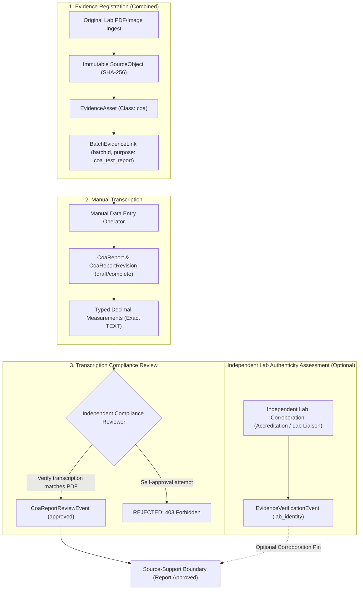

# Certificate of Analysis (CoA) Manual Transcription and Verification Runbook

> [!IMPORTANT]
> **Operational Authority Notice:**
> Entering laboratory data through the manual transcription workflow records **reported laboratory assertions**. Transcribing values, attaching PDF/image certificates, or creating structured report records **does NOT confer laboratory authenticity, release eligibility, or regulatory claim approval**.
> Manual data entry and independent authenticity assessment are strictly separated authorities.

Parent: #469 — Phase 1 (Verified batch and evidence records)  
Issue: #474 / VPM-P1.5 (Source-backed CoA reports and typed measurements per batch)  
Governing Architecture: [ADR 0009](adr/0009-verified-product-batch-evidence-claim-authority.md)

---

## 1. Authority Boundaries and Separation of Duties

The platform strictly enforces four decoupled authorities:

### 1.1 The Non-Self-Approval Invariant
- **Rule:** No operator or technician who asserted or recorded a CoA report revision (`assertedBy`) may issue an approval review event (`reviewReportRevision`) for that same revision.
- **Enforcement:** Enforced at domain, application, and HTTP layers. An attempt by the assertor to approve returns HTTP 403 Forbidden with error code `SELF_APPROVAL_FORBIDDEN` ("Self-approval forbidden: reviewer cannot be the recorder who asserted this report revision").
- **Audit Requirement:** The recorder (`assertedBy`, `assertedAt`) and the reviewer (`actorId`, `occurredAt`) must be distinct human actors recorded in the immutable audit ledger.

### 1.2 Separation of Authorities
| Dimension | Manual Entry (Transcription) | Transcription Compliance Review | Independent Authenticity Assessment |
| :--- | :--- | :--- | :--- |
| **Actor** | Transcription Operator / Lab Technician | Authorized Compliance Reviewer | Compliance Officer / Lab Liaison |
| **Object of Record** | `CoaReportRevision`, `CoaMeasurement` | `CoaReportReviewEvent` (`approved`) | `EvidenceVerificationEvent` (`lab_identity`) |
| **Authority** | Transcribes verbatim assertions from the certificate | Certifies transcription matches uploaded certificate bytes | Corroborates that the lab is accredited and the report is authentic |
| **Source Dependency** | Requires active, byte-verified `EvidenceAsset` | Requires active `CoaReport` and distinct reviewer identity | Requires direct third-party corroboration with issuing lab |
| **Effect on Downstream Claims** | Creates draft or pending reported facts | Approves report revision for measurement support resolution | Optionally reinforces source-support with verified lab identity |

---

## 2. Control API HTTP Endpoints and Accepted Request Schemas

All mutation commands are executed inside a tenant-scoped HTTP session under `/api/v1/clients/:clientId/batches/:batchId/coa-reports`.
Every mutation requires a client-generated UUIDv7 `actionId` (either inside the request body or via the `x-action-id` HTTP header). If supplied in both, they must match identically. Idempotent retries sharing an `actionId` safely return the cached command receipt.

### HTTP Endpoints Summary
| Operation | Method & Path | Status | Response Envelope |
| :--- | :--- | :--- | :--- |
| Create Report | `POST /api/v1/clients/:clientId/batches/:batchId/coa-reports` | 201 Created | `{ report, currentRevision }` |
| List Reports | `GET /api/v1/clients/:clientId/batches/:batchId/coa-reports` | 200 OK | `{ reports: [...] }` |
| Get Head Report | `GET /api/v1/clients/:clientId/batches/:batchId/coa-reports/:reportId` | 200 OK | `{ report, currentRevision }` |
| Get Specific Revision | `GET /api/v1/clients/:clientId/batches/:batchId/coa-reports/:reportId/revisions/:revision` | 200 OK | `CoaReportRevisionContract` |
| Supersede Report | `POST /api/v1/clients/:clientId/batches/:batchId/coa-reports/:reportId/supersede` | 200 OK | `{ report, currentRevision }` |
| Review Report | `POST /api/v1/clients/:clientId/batches/:batchId/coa-reports/:reportId/review` | 200 OK | `{ report, decisionEvent }` |
| Archive Report | `POST /api/v1/clients/:clientId/batches/:batchId/coa-reports/:reportId/archive` | 200 OK | `CoaReport` |

### 2.1 `createCoaReport` (`CreateCoaReportHttpRequest`)
Creates a new `CoaReport` head (version 1) and its initial `CoaReportRevision` (revision 1) linked to an existing batch and registered `EvidenceAsset`:

> [!NOTE]
> `reportId` is strictly assigned by the server on HTTP create; callers must omit `reportId` from the JSON request body.

| Field | Type | Required? | Description |
| :--- | :--- | :--- | :--- |
| `actionId` | UUIDv7 string | **Required** | Idempotent operation UUIDv7 (may also be provided via `x-action-id`). |
| `evidenceId` | UUID string | **Required** | Pinned `EvidenceAsset` ID (MIME must be PDF or image). |
| `evidenceRevision` | Positive integer | **Required** | Target revision of the evidence asset. |
| `completenessStatus` | `'draft'` \| `'complete'` | **Required** | Drafts permit staging; complete requires full metadata and $\ge 1$ measurement. |
| `reportIdentifierAsClaimed`| String | Required if complete | Verbatim laboratory certificate number (trimmed). |
| `reportDate` | Date string (`YYYY-MM-DD`) | Required if complete | Issue date shown on certificate ($\le$ recording date). |
| `labNameAsClaimed` | String | Required if complete | Verbatim corporate or trade name of the testing lab. |
| `sampleIdentifierAsClaimed`| String | Required if complete | Laboratory sample / accession ID. |
| `scopeKind` | `'sample_only'` \| `'attributed_lot'` | Required if complete | Scope of test results. |
| `scopeDescription` | String | Required if complete | Description of sample or lot scope. |
| `sampleDate` | Date string (`YYYY-MM-DD`) | Optional | Date sample was taken ($\le reportDate$). |
| `samplingMethodDescription`| String | Optional | Field sampling protocol description. |
| `sampleToBatchAssociationConfirmed` | Boolean | Required if complete | Operator confirmation that sample originates from batch (must be `true` for complete). |
| `sampleToBatchAssociationAttestation` | String | Required if complete | Documented rationale confirming sample origin (e.g. METRC tag, CoC). |
| `verifiedLabIdentityEventId` | UUID string | Optional | Link to independent `EvidenceVerificationEvent` corroborating lab identity. |
| `measurements` | Array of measurement objects | Required ($\ge 1$ if complete) | Typed measurement panel rows. |

### 2.2 Measurement Panel Row (`CreateCoaMeasurementInput`)
Each row represents one reported laboratory analyte measurement:

| Field | Type | Description |
| :--- | :--- | :--- |
| `analyte` | String (1..128) | Name or standardized code of analyte (e.g. `'THCA'`, `'myrcene'`). Context must be unique per report revision. |
| `resultKind` | `'quantified'` \| `'below_limit'` \| `'not_detected'` | Analytical result type. Payloads are mutually exclusive. |
| `resultValue` | Exact decimal string | Value when `quantified`. Conforms to `^-?(0\|[1-9][0-9]*)(\.[0-9]+)?$`. Null for non-quantified. |
| `resultLimit` | Exact decimal string | Limit threshold when `below_limit`. Null otherwise. |
| `resultQualifier` | `'lt'` \| `'lte'` | Analytical qualifier when `below_limit`. Null otherwise. |
| `unit` | String (1..64) | Exact unit of measure (e.g. `'percent_w_w'`, `'mg_per_g'`). |
| `basis` | String (1..64) | Analytical basis (e.g. `'dry_weight'`, `'as_received'`). |
| `context` | String (1..64) | Product / matrix context (e.g. `'flower'`, `'extract'`). |
| `quantityKind` | String (1..64) | Physical dimension (e.g. `'mass_fraction'`, `'mass_concentration'`). |
| `methodAsReported` | String \| null | Test method name from certificate. Null when absent from source; never fabricate placeholders. |
| `uncertaintyAbsolute`| Exact decimal string \| null | Absolute uncertainty in row unit/basis. |
| `detectionLimit` | Exact decimal string \| null | Method detection limit (LOD). Must be $\le$ quantification limit. |
| `quantificationLimit`| Exact decimal string \| null | Method limit of quantification (LOQ). |
| `analyticalQualifierCode` | String \| null | Analytical qualifier code (e.g. `'negative_as_reported'`). |
| `analyticalQualifierExplanation` | String \| null | Rationale for qualifier. Required if negative quantified value is reported. |

### 2.3 `supersedeCoaReport` (`SupersedeCoaReportRequest`)
Creates a new revision (revision $N+1$) under the existing report head, advancing head version:

- **Accepted Fields:** `expectedVersion`, `evidenceRevision`, `completenessStatus`, transcribed metadata fields (same as create), and `measurements`.
- **Invariants:**
  - `expectedVersion`: Must match current `version` of report head (optimistic concurrency guard).
  - Do **NOT** provide `reportId`, `batchId`, `evidenceId`, or `supersedesRevision` in the request body. `reportId` is supplied in the URL/envelope path; `batchId` and `evidenceId` are permanently fixed to the report head; `supersedesRevision` is automatically set to the current revision ($N$), and new revision index is computed as $N+1$.
  - Resets revision review status to `pending`. Prior revisions and measurements remain permanently immutable.

### 2.4 `reviewReportRevision` (`ReviewCoaReportRequest`)
Records an authoritative compliance review decision for a specific report revision:

| Field | Type | Description |
| :--- | :--- | :--- |
| `expectedVersion` | Positive integer | Expected current version of the report head. |
| `decision` | `'approved'` \| `'rejected'` | Review outcome. |
| `reason` | String (1..1000) | Detailed rationale documenting verification against original certificate bytes. |
| `assessedScope` | `'sample_only'` \| `'attributed_lot'` | Compliance assessed scope. Cannot exceed report's transcribed `scopeKind` (`sample_only` reports cannot be approved as `attributed_lot`). |

- **Non-Self-Approval:** The reviewer (`actorId` in envelope) **cannot** be the recorder (`assertedBy`) who created or superseded this report revision.

### 2.5 `archiveCoaReport` (`ArchiveCoaReportRequest`)
Terminal archiving of a report head:

| Field | Type | Description |
| :--- | :--- | :--- |
| `expectedVersion` | Positive integer | Expected current version of the report head. |

- Sets `archivedAt` timestamp. Archived reports cannot be unarchived, superseded, or reviewed, and fail measurement support resolution closed. Historical audit trails remain readable.

### 2.6 `resolveMeasurementSupport` (`ResolveCoaMeasurementSupportQuery`)
Queries whether pinned batch measurements are valid, approved, and source-supported:

- **Parameters:** `clientId`, `batchId`, `reportId`, `reportRevision`, `measurementIds`, `requiredUnit`, `requiredBasis`, `requiredContext`, `requiredScope`.
- **Guarantees:** Evaluates current report head, revision review status, source object availability, active disputes, and analytical tuple compatibility under database locks. Fails closed with specific reason codes if any check fails. Never silently redirects to a "latest" report.

---

## 3. Standard Operating Procedures (SOP)

### SOP-01: Pre-requisites Before Manual Transcription
Before creating a `CoaReport`:
1. The target `ProductSku` and `ProductBatch` must exist and be active (not archived).
2. The original laboratory Certificate of Analysis (PDF or high-resolution image) must be registered via `RegisterEvidenceAsset` with `sourceClass = 'coa'`, `purpose = 'coa_test_report'`, and the target `batchId`. This combined command executes source object ingest (with byte SHA-256 verification), evidence asset creation, and batch linking in one atomic operation.
3. Ensure the registered evidence asset has no active `disputed` or `withdrawn` verification events.

### SOP-02: Transcription of Laboratory Report Metadata
Operators must transcribe report metadata with verbatim fidelity:
- **`reportIdentifierAsClaimed`:** Exact certificate / report number (e.g. `RPT-2026-03-998`). Leading/trailing whitespace is trimmed; internal punctuation is preserved.
- **`reportDate`:** Issue date shown on the certificate (`YYYY-MM-DD`). Must not be in the future relative to the recording timestamp.
- **`labNameAsClaimed`:** Exact corporate or trade name of the testing laboratory (e.g. `Steep Hill Analytical Labs`).
- **`sampleIdentifierAsClaimed`:** Laboratory sample / accession ID.
- **`scopeKind`:**
  - `sample_only`: Use when the certificate represents only the submitted physical sample without accredited lot-level composite sampling documentation.
  - `attributed_lot`: Use ONLY when the certificate and chain-of-custody explicitly document certified lot-composite sampling protocol.
- **`sampleToBatchAssociationAttestation`:** Non-empty rationale explaining how the sample was confirmed to originate from this batch (e.g., `Chain-of-custody lot tag matches METRC tag #1A406030000212300000042`).
- **`completenessStatus`:**
  - `draft`: Operator has partial information or is staging data. Drafts may omit certain claimed text fields but cannot support downstream claims.
  - `complete`: All required certificate metadata and analytical measurements are entered. Complete reports require at least one measurement and confirmed sample-to-batch association.

### SOP-03: Analytical Measurements & Exact Decimal Storage Rules
- **Rule 1: Exact Decimal String Formatting:**
  - Never enter floating-point numbers or scientific notation.
  - All values must strictly conform to `^-?(0|[1-9][0-9]*)(\.[0-9]+)?$`.
  - Trailing zeros carry analytical precision and MUST be preserved verbatim: e.g., if the lab reports `24.5000%`, enter `"24.5000"`, NOT `"24.5"` or `"24.50"`.
- **Rule 2: Result Kinds:**
  - `quantified`: Exact numerical result above LOQ (Limit of Quantification). Requires non-null `resultValue`.
  - `below_limit`: Measured analyte is below quantification or detection limit. Requires non-null `resultLimit` and `resultQualifier` (`lt` or `lte`). **Never convert below-limit values to numerical zero or 0.00%**.
  - `not_detected`: Instrument detected no analytical peak. `resultValue` and `resultLimit` must be null.
- **Rule 3: Explicit Units, Basis, and Context:**
  - Every measurement row requires unambiguous `unit` (e.g. `percent_w_w`, `mg_per_g`, `ppm`), `basis` (e.g. `dry_weight`, `as_received`), `context` (e.g. `finished_flower`, `extract`), and `quantityKind` (e.g. `mass_fraction`, `mass_concentration`).
  - Unit conversions at claim publication time are strictly forbidden. Values are supported only for identical unit/basis/context tuples.
- **Rule 4: Optional Reported Method & Metadata:**
  - `methodAsReported`: Optional string (nullable). When present on the source report, transcribe verbatim. When not specified on the source, leave null—do not fabricate placeholder strings.
  - `uncertaintyAbsolute`, `detectionLimit`, `quantificationLimit`: Optional decimal strings sharing the row's unit/basis.

### SOP-04: Handling Laboratory Re-tests and Corrections (Supersession)
When a laboratory issues an amended or corrected report:
1. **Never mutate existing records:** Prior revisions and measurements are permanently immutable.
2. Ingest the amended PDF as a new `EvidenceAsset` or new `EvidenceRevision` via `RegisterEvidenceAsset`.
3. Submit `supersedeCoaReport` with the accepted request payload:
   - `expectedVersion`: Must match the current `version` of the `CoaReport` head.
   - `evidenceRevision`: The target evidence revision index.
   - `completenessStatus`: `'draft'` or `'complete'`.
   - Transcribed metadata fields (`reportIdentifierAsClaimed`, `reportDate`, etc.).
   - `measurements`: The updated complete measurement panel.
   - **Note:** Do NOT provide `supersedesRevision` in the request body; the system automatically sets `supersedesRevision` to the current revision and advances revision index by exactly 1.
4. The system automatically computes the next revision index, seals the new measurement panel, resets review status to pending, and records supersession lineage.
5. All previous measurements remain fully intact in the database ledger for regulatory and legal audit trails.

### SOP-05: Reviewer Verification and Approval
1. The compliance reviewer navigates to the unapproved report revision.
2. The reviewer opens the original PDF/image from `restricted_original` storage.
3. The reviewer independently verifies each transcribed decimal value against the original visual document.
4. If verified, the reviewer submits `reviewReportRevision` (`decision: 'approved'`, `expectedVersion: <currentVersion>`, `reason: '...'`, `assessedScope: 'sample_only' | 'attributed_lot'`).
5. If errors or discrepancies exist, the reviewer submits `reviewReportRevision` (`decision: 'rejected'`) and requires the operator to supersede with a corrected revision.

---

## 4. Failure Modes and Emergency Procedures

### 4.1 Resolving Measurement Support Denial
If a downstream commercial claim fails source support resolution, consult the denial reason code:

| Reason Code | Root Cause | Operator Action |
| :--- | :--- | :--- |
| `report_not_found` | Invalid report ID or wrong client tenant ID | Verify client and report UUIDs. |
| `report_archived` | CoA report head has been marked archived | Inspect audit log to determine who archived the report. Archived reports cannot be revived. |
| `report_superseded` | Pinned revision is no longer current revision | Re-target downstream claim to the newly approved report revision. |
| `revision_not_found` | Requested revision index does not exist | Check report revision history. |
| `report_draft_incomplete` | Report revision has `completenessStatus = 'draft'` | Complete transcription and transition to `complete`. |
| `sample_association_unconfirmed` | Sample-to-batch confirmation was not attested | Confirm sample origin with lab and update revision. |
| `batch_link_missing` | Batch-evidence link is absent for this evidence revision | Verify batch link in evidence registry. |
| `report_not_approved` | Report is pending review | Request authorized reviewer to review and approve revision. |
| `report_rejected` | Reviewer rejected the report revision | Create a new corrected revision via `supersedeCoaReport`. |
| `source_disputed` | Laboratory or regulator lodged a dispute against the evidence asset | Halt claim authoring; resolve legal/regulatory inquiry before lifting dispute. |
| `source_unavailable` / `source_quarantined` | Original file is quarantined or unavailable | Inspect object storage integrity and SHA-256 digest. |
| `lab_identity_unverified` | Referenced lab verification event is missing or not verified | Ensure the lab corroboration event exists and outcome is `verified`. |
| `lab_verification_withdrawn` | Corroborating lab verification was withdrawn | Inspect verification audit ledger for withdrawal reason. |
| `measurement_not_found` | Measurement ID does not belong to this revision | Check measurement ID list for exact revision linkage. |
| `unit_mismatch` / `basis_mismatch` / `context_mismatch` | Requested unit, basis, or context differs from transcribed report | Verify analytical requirements. General unit conversions are forbidden. |
| `mixed_measurement_contexts` | Panel contains heterogeneous units/contexts | Request measurements with uniform analytical tuples. |
| `scope_insufficient` | Requested `attributed_lot` scope on `sample_only` report | Lot-wide claims cannot be supported by sample-only tests without certified composite sampling. |
