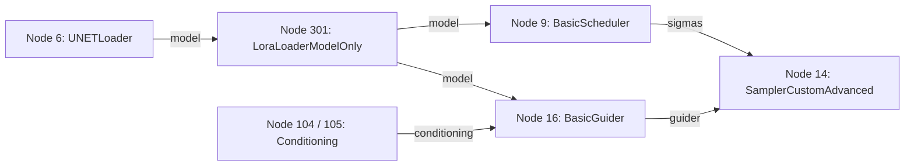
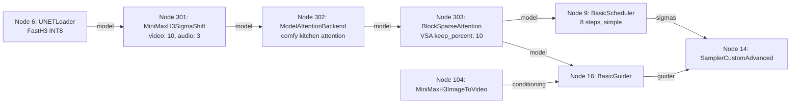

# MiniMax-H3 Step-Reduction & Distillation Experiments Specification

## 1. Executive Summary & Objective

This document defines the research, provenance, graph compilation, and candidate validation framework for materially faster MiniMax-H3 inference via model-specific distilled checkpoints and Turbo/Lightning LoRAs (Issue #443).

**Scope & Governance Boundary:**
- Autonomous engineering and offline graph compilation only.
- Pinned production templates, baseline model files, and production render-profiles remain strictly unchanged.
- Offline CI cannot and does not claim real throughput gains or aesthetic equivalence.
- Physical execution on dedicated NVIDIA RTX 4090 render hosts, performance benchmarking, visual review, and operator promotion decisions remain exclusively within Issue #445.

---

## 2. Pinned Model Weights & LoRA Provenance

All model weights, distilled checkpoints, and LoRA adapters are pinned to immutable source repository revisions and cryptographic SHA-256 digests. Pinned baseline model files are preserved intact; candidate models use isolated storage locations.

| Recipe Name | Target Route | Diffusion Checkpoint | LoRA Adapter | Scheduler / Sampler / Steps | Flow Shifts | Required Runtime Revision |
| :--- | :--- | :--- | :--- | :--- | :--- | :--- |
| `canonical-base-20` | `i2v` / `ref2v` | `minimax_h3_ref2va_pruned_int8_convrot.safetensors` | None | `simple` / `res_multistep` / 20 steps | 12 (video) / 3 (audio) | `55b6a9b11dffecdd65a3ccd5eb6a1b3a178c96dc` (ComfyUI 0.33.0) |
| `fl2va-base-20` | `i2v` | `minimax_h3_fl2va_pruned_int8_convrot.safetensors` | None | `simple` / `res_multistep` / 20 steps | 12 (video) / 3 (audio) | `55b6a9b11dffecdd65a3ccd5eb6a1b3a178c96dc` (ComfyUI 0.33.0) |
| `fl2va-turbo-8` | `i2v` | `minimax_h3_fl2va_pruned_int8_convrot.safetensors` | `minimax_h3_fl2v_turbo_8step_v1.0_comfyui_bf16.safetensors` | `simple` / `res_multistep` / 8 steps | 12 (video) / 3 (audio) | `55b6a9b11dffecdd65a3ccd5eb6a1b3a178c96dc` (ComfyUI 0.33.0) |
| `ref2va-turbo-4` | `ref2v` | `minimax_h3_ref2va_pruned_int8_convrot.safetensors` | `minimax_h3_ref2v_turbo_4step_v0.1_comfyui_bf16.safetensors` | `simple` / `res_multistep` / 4 steps | 12 (video) / 3 (audio) | `55b6a9b11dffecdd65a3ccd5eb6a1b3a178c96dc` (ComfyUI 0.33.0) |
| `fasth3-i2v-8` | `i2v` | `fastvideo_fasth3_8step_v2_pruned_int8_convrot.safetensors` | None | `simple` / `res_multistep` / 8 steps | 10 (video) / 3 (audio) | `ee71d5c4993f29086b27fde1629a945ae48425bf` (ComfyUI 0.36.0) |

### Cryptographic Hashes & File Manifest

1. **Ref2VA Pruned INT8 Checkpoint:**
   - File: `diffusion_models/minimax_h3_ref2va_pruned_int8_convrot.safetensors`
   - Repository: `Comfy-Org/MiniMax-H3` @ revision `7e75982b97cd5a41d2dcfa1904ee88d0686d6fd1`
   - SHA-256: `9255f52b6677845ad238f20dfaafa94727053694127ab7f255c048f0f9365779`
   - Size: 20,970,379,616 bytes (~20.97 GB)
   - License: MiniMax Community License

2. **FL2VA Pruned INT8 Checkpoint:**
   - File: `diffusion_models/minimax_h3_fl2va_pruned_int8_convrot.safetensors`
   - Repository: `Comfy-Org/MiniMax-H3` @ revision `7e75982b97cd5a41d2dcfa1904ee88d0686d6fd1`
   - SHA-256: `e889202c41dafb67b10d67b97f0d8541508036a6090af23425a5c2615d03c47a`
   - Size: 20,970,379,616 bytes (~20.97 GB)
   - License: MiniMax Community License

3. **FL2VA Turbo 8-step LoRA Adapter:**
   - File: `loras/minimax_h3_fl2v_turbo_8step_v1.0_comfyui_bf16.safetensors`
   - Repository: `lightx2v/Minimax-h3-Turbo` @ revision `3ec17a324ced54151364f24f8b5fb6bf7e26414f`
   - SHA-256: `2339acdf19bfe123f46b971ea35d367a84adb85de43627e1eceafa5a5b2b111e`
   - Size: 1,956,193,000 bytes (~1.96 GB)
   - License: Apache-2.0 (Note: adapter license does not override underlying MiniMax Community License restrictions on generated outputs)

4. **Ref2VA Turbo 4-step LoRA Adapter:**
   - File: `loras/minimax_h3_ref2v_turbo_4step_v0.1_comfyui_bf16.safetensors`
   - Repository: `Comfy-Org/MiniMax-H3` @ revision `7e75982b97cd5a41d2dcfa1904ee88d0686d6fd1`
   - SHA-256: `5b9ab5ade15d0775676d01a907268a69a1468dc6033b3b0d3ded5502f3ebb84c`
   - Size: 1,956,193,000 bytes (~1.96 GB)
   - License: MiniMax Community License

5. **FastH3 Distilled 8-step INT8 Checkpoint:**
   - File: `diffusion_models/fastvideo_fasth3_8step_v2_pruned_int8_convrot.safetensors`
   - Repository: `FastVideo/FastVideo-FastH3-Comfy` @ revision `ec1e3aa374a91c57b0b94a1623b7e657c0498cf2`
   - SHA-256: `0922785978dc9bfe1adf27d8b291b0ca763f9f165f882e6cb297c72fbb6deda8`
   - Size: 22,128,378,696 bytes (~22.13 GB)
   - License: MiniMax Community License

6. **Shared Auxiliary Models (Identical across all recipes):**
   - Text Encoder: `text_encoders/qwen3vl_32b_minimax_h3_nvfp4_awq.safetensors` (SHA-256: `35a88d51044231fe332301d7a62aa81e3f2cba62febeb446e2c1e3e0ef76f2c6`, 15.69 GB)
   - Video VAE: `vae/minimax_h3_video_vae_int8_convrot.safetensors` (SHA-256: `52a2c8c73583c86e4f41cdcce3a6ad0ea562987bc0bf3d60a0cef5f5c8e60c0e`, 2.81 GB)
   - Audio VAE: `vae/minimax_h3_audio_vae_fp32.safetensors` (SHA-256: `8e505d95dd1561d47abd43d4238fd40d9bb1ae9e147ed0a4cba778d76ae4db48`, 0.61 GB)

---

## 3. Route Fencing & Architectural Rules

### FastH3 Route Limitation
- **Strictly restricted to I2V / frame-anchored route:** Upstream FastVideo FastH3 weights and official ComfyUI templates support T2VA and FL2VA I2V only.
- **Reference-directed Ref2V strictly rejected:** There is no source-backed Ref2VA variant of FastH3 compatible with `MiniMaxH3ReferenceToVideo`. FastH3 cannot consume ordered reference image bindings with Picture tags. FastH3 must never be mapped to `reference_directed` mode. Any attempt to compile FastH3 with `route: "ref2v"` fails closed before dispatch.
- Sources:
  - [Comfy-Org FastH3 Tutorial](https://github.com/Comfy-Org/docs/blob/71f2c354cc6ea0ad43ca17989f5797ae0863ddc7/tutorials/video/minimax/minimax-h3-fastvideo.mdx)
  - [Official FastH3 Template](https://github.com/Comfy-Org/workflow_templates/blob/3e89967349dd95fa68ce3b36966f41d642af8ea7/templates/video_fastvideo_fasth3_i2v.json)

### Legacy Ref2VA-as-I2V Pairing
- In the canonical baseline template (`templates/minimax_h3_720p_i2v_124f_api.json`), the I2V workflow loads the Ref2VA checkpoint. As audited in `docs/minimax-h3-checkpoint-conditioning-audit.md`, the semantic applicability of this legacy pairing remains unknown.
- Neither Turbo LoRA (FL2VA 8-step or Ref2VA 4-step) is compatible with this legacy Ref2VA-as-I2V pairing. Applying FL2VA Turbo LoRA requires the FL2VA base checkpoint. Any graph combining Ref2VA checkpoint with I2V conditioning and Turbo LoRA is rejected.

### Step-Reduction Schedules
- Schedule steps are fixed to their audited distilled values: 8 steps for `fl2va-turbo-8`, 4 steps for `ref2va-turbo-4`, 8 steps for `fasth3-i2v-8`, and 20 steps for base models.
- Arbitrary step reductions without compatible distillation (e.g. running base models at 8 steps) are not acceptable substitutes for Turbo/Lightning distillation. If intermediate step counts are evaluated as base-schedule controls, they must be explicitly labeled as altered-behavior controls.

---

## 4. Graph Topologies & Model Chains

### Turbo LoRA Model Chain (Production Core `55b6a9b11dffecdd65a3ccd5eb6a1b3a178c96dc`)

- `LoraLoaderModelOnly`: `lora_name = <pinned_lora>`, `strength_model = 1.0`.
- Native ComfyUI node in `nodes.py`, fully supported on production core revision.

### FastH3 VSA Model Chain (Isolated Upgrade Core `ee71d5c4993f29086b27fde1629a945ae48425bf`)


---

## 5. Resource Profile & System Requirements

| Candidate | Additional Disk Space | Estimated Peak VRAM | Estimated Peak Host RAM | Execution Core |
| :--- | :--- | :--- | :--- | :--- |
| `fl2va-base-20` | ~20.97 GB (FL2VA checkpoint) | ~19.5 GB | ~38 GB | Pinned Production Core (`55b6a9b11dffecdd65a3ccd5eb6a1b3a178c96dc`) |
| `fl2va-turbo-8` | ~22.93 GB (FL2VA + LoRA) | ~20.5 GB (BF16 LoRA merge buffer) | ~40 GB | Pinned Production Core (`55b6a9b11dffecdd65a3ccd5eb6a1b3a178c96dc`) |
| `ref2va-turbo-4` | ~1.96 GB (LoRA only; Ref2VA in base) | ~20.5 GB (BF16 LoRA merge buffer) | ~40 GB | Pinned Production Core (`55b6a9b11dffecdd65a3ccd5eb6a1b3a178c96dc`) |
| `fasth3-i2v-8` | ~22.13 GB (FastH3 checkpoint) | ~18.5 - 21.0 GB (VSA activation buffers) | ~42 GB | Isolated ComfyUI 0.36.0 (`ee71d5c4993f29086b27fde1629a945ae48425bf`) |

*Note: Peak VRAM and host RAM figures are preliminary estimates based on architecture review; physical hardware measurement remains exclusively Issue #445.*

---

## 6. Creative Failure Modes & Qualitative Evaluation Rubric

Step reduction and distillation introduce distinct creative failure modes that must be independently reviewed and decided by human operators. Automated harnesses must record observed facts without fabricating visual quality scores.

1. **Appearance & Wardrobe Drift:**
   - Symptoms: Loss of fabric texture, clothing color shifts, simplification of intricate garments across frames.
   - Cause: Reduced denoising iterations weaken fine latent detail reconstruction.
2. **Scene & Background Replacement:**
   - Symptoms: Background geometry morphing, unexpected lighting changes, loss of background continuity.
   - Cause: Coarser trajectory integration in early sampling steps.
3. **Camera-Motion Deviation:**
   - Symptoms: Jittery panning, unexpected perspective shifts, motion dampening or excessive velocity.
   - Cause: Flow-shift schedule modifications altering low-frequency spatial-temporal latents.
4. **Facial & Anatomical Anomalies:**
   - Symptoms: Blurring of eyes, distorted teeth/fingers, expression freezing or unnatural warping.
   - Cause: Insufficient step count to resolve micro-features; LoRA rank bottleneck.
5. **Audio Adherence & Synchronization:**
   - Symptoms: Desynchronization between visual speech cues and synthesized audio, degradation of background soundscape.
   - Cause: Shared latent schedule distortion affecting audio VAE decoding.
6. **Reference Fidelity (Ref2V):**
   - Symptoms: Deviation from supplied reference images (characters, items, environments).
   - Cause: Fewer steps reduce cross-attention influence from reference conditioning.

---

## 7. Operator Provisioning & Test Execution Procedure

> [!IMPORTANT]
> Physical hardware benchmarking, visual quality review, and production enablement are strictly out of scope for automated agents and belong exclusively to human operators on the dedicated RTX 4090 render host in Issue #445.
> Automated CI performs only offline graph derivation, dry-run validation, and contract verification.

### 7.1 Environment Setup & Prerequisites

1. **Hardware & OS Requirements:**
   - Dedicated NVIDIA RTX 4090 GPU (24GB VRAM) with Driver >= 560.35.03 and CUDA 12.4.
   - Host system with >= 64GB RAM and >= 100GB free NVMe SSD storage.

2. **ComfyUI Checkout Provisioning:**
   - **Production Baseline & Turbo LoRA Core (0.33.0):**
     ```bash
     mkdir -p /opt/comfyui
     git clone https://github.com/Comfy-Org/ComfyUI.git /opt/comfyui
     cd /opt/comfyui
     git checkout 55b6a9b11dffecdd65a3ccd5eb6a1b3a178c96dc
     python3 -m venv venv
     ./venv/bin/pip install torch==2.5.1+cu124 torchvision torchaudio --extra-index-url https://download.pytorch.org/whl/cu124
     ./venv/bin/pip install -r requirements.txt
     cd -
     # Verify ComfyUI core checkout from orchestrator repository root:
     ./scripts/check-comfyui-version.sh --comfy-dir /opt/comfyui
     ```
   - **FastH3 Isolated Upgrade Core (0.36.0):**
     ```bash
     mkdir -p /opt/comfyui-fasth3
     git clone https://github.com/Comfy-Org/ComfyUI.git /opt/comfyui-fasth3
     cd /opt/comfyui-fasth3
     git checkout ee71d5c4993f29086b27fde1629a945ae48425bf
     python3 -m venv venv
     ./venv/bin/pip install torch==2.5.1+cu124 torchvision torchaudio --extra-index-url https://download.pytorch.org/whl/cu124
     ./venv/bin/pip install -r requirements.txt
     ./venv/bin/pip install comfy-kitchen==0.2.34
     cd -
     ```

### 7.2 Model Weights Provisioning & Checksum Verification

Download candidate models from official Hugging Face repositories at immutable revisions into isolated directories.
Downloads use an atomic `.tmp` buffer with a fail-fast SHA-256 verification guard that refuses to overwrite existing verified models:

```bash
MODELS_DIR="/opt/comfyui/models"
mkdir -p "${MODELS_DIR}/diffusion_models" "${MODELS_DIR}/loras" "${MODELS_DIR}/text_encoders" "${MODELS_DIR}/vae"

download_and_verify() {
  local url="$1"
  local expected_hash="$2"
  local target_path="$3"

  if [[ -f "${target_path}" ]]; then
    local current_hash
    current_hash=$(sha256sum "${target_path}" | awk '{print $1}')
    if [[ "${current_hash}" == "${expected_hash}" ]]; then
      echo "File ${target_path} already exists with verified checksum."
      return 0
    else
      echo "Error: ${target_path} exists with unexpected checksum ${current_hash}. Refusing to overwrite." >&2
      return 1
    fi
  fi

  local tmp_path="${target_path}.tmp"
  mkdir -p "$(dirname "${target_path}")"
  echo "Downloading $(basename "${target_path}")..."
  if curl -fL -o "${tmp_path}" "${url}" && echo "${expected_hash}  ${tmp_path}" | sha256sum -c -; then
    mv "${tmp_path}" "${target_path}"
    echo "Verified and staged ${target_path}"
  else
    rm -f "${tmp_path}"
    echo "Error: Download or verification failed for $(basename "${target_path}")" >&2
    return 1
  fi
}

# 1. Ref2VA Base Checkpoint (7e75982b)
download_and_verify \
  "https://huggingface.co/Comfy-Org/MiniMax-H3/resolve/7e75982b97cd5a41d2dcfa1904ee88d0686d6fd1/diffusion_models/minimax_h3_ref2va_pruned_int8_convrot.safetensors" \
  "9255f52b6677845ad238f20dfaafa94727053694127ab7f255c048f0f9365779" \
  "${MODELS_DIR}/diffusion_models/minimax_h3_ref2va_pruned_int8_convrot.safetensors"

# 2. FL2VA Base Checkpoint (7e75982b)
download_and_verify \
  "https://huggingface.co/Comfy-Org/MiniMax-H3/resolve/7e75982b97cd5a41d2dcfa1904ee88d0686d6fd1/diffusion_models/minimax_h3_fl2va_pruned_int8_convrot.safetensors" \
  "e889202c41dafb67b10d67b97f0d8541508036a6090af23425a5c2615d03c47a" \
  "${MODELS_DIR}/diffusion_models/minimax_h3_fl2va_pruned_int8_convrot.safetensors"

# 3. FL2VA Turbo 8-step LoRA (3ec17a32)
download_and_verify \
  "https://huggingface.co/lightx2v/Minimax-h3-Turbo/resolve/3ec17a324ced54151364f24f8b5fb6bf7e26414f/minimax_h3_fl2v_turbo_8step_v1.0_comfyui_bf16.safetensors" \
  "2339acdf19bfe123f46b971ea35d367a84adb85de43627e1eceafa5a5b2b111e" \
  "${MODELS_DIR}/loras/minimax_h3_fl2v_turbo_8step_v1.0_comfyui_bf16.safetensors"

# 4. Ref2VA Turbo 4-step LoRA (3ec17a32)
download_and_verify \
  "https://huggingface.co/lightx2v/Minimax-h3-Turbo/resolve/3ec17a324ced54151364f24f8b5fb6bf7e26414f/minimax_h3_ref2v_turbo_4step_v0.1_comfyui_bf16.safetensors" \
  "5b9ab5ade15d0775676d01a907268a69a1468dc6033b3b0d3ded5502f3ebb84c" \
  "${MODELS_DIR}/loras/minimax_h3_ref2v_turbo_4step_v0.1_comfyui_bf16.safetensors"

# 5. Shared Text Encoder & VAEs
download_and_verify \
  "https://huggingface.co/Comfy-Org/MiniMax-H3/resolve/7e75982b97cd5a41d2dcfa1904ee88d0686d6fd1/text_encoders/qwen3vl_32b_minimax_h3_nvfp4_awq.safetensors" \
  "35a88d51044231fe332301d7a62aa81e3f2cba62febeb446e2c1e3e0ef76f2c6" \
  "${MODELS_DIR}/text_encoders/qwen3vl_32b_minimax_h3_nvfp4_awq.safetensors"

download_and_verify \
  "https://huggingface.co/Comfy-Org/MiniMax-H3/resolve/7e75982b97cd5a41d2dcfa1904ee88d0686d6fd1/vae/minimax_h3_video_vae_int8_convrot.safetensors" \
  "52a2c8c73583c86e4f41cdcce3a6ad0ea562987bc0bf3d60a0cef5f5c8e60c0e" \
  "${MODELS_DIR}/vae/minimax_h3_video_vae_int8_convrot.safetensors"

download_and_verify \
  "https://huggingface.co/Comfy-Org/MiniMax-H3/resolve/7e75982b97cd5a41d2dcfa1904ee88d0686d6fd1/vae/minimax_h3_audio_vae_fp32.safetensors" \
  "8e505d95dd1561d47abd43d4238fd40d9bb1ae9e147ed0a4cba778d76ae4db48" \
  "${MODELS_DIR}/vae/minimax_h3_audio_vae_fp32.safetensors"

# 6. FastH3 8-step Distilled Checkpoint (ec1e3aa3) — Isolated FastH3 Checkout
FASTH3_DIFF_DIR="/opt/comfyui-fasth3/models/diffusion_models"
mkdir -p "${FASTH3_DIFF_DIR}"
download_and_verify \
  "https://huggingface.co/FastVideo/FastVideo-FastH3-Comfy/resolve/ec1e3aa374a91c57b0b94a1623b7e657c0498cf2/diffusion_models/fastvideo_fasth3_8step_v2_pruned_int8_convrot.safetensors" \
  "0922785978dc9bfe1adf27d8b291b0ca763f9f165f882e6cb297c72fbb6deda8" \
  "${FASTH3_DIFF_DIR}/fastvideo_fasth3_8step_v2_pruned_int8_convrot.safetensors"

# Link shared text encoder and VAEs to FastH3 checkout
mkdir -p /opt/comfyui-fasth3/models/text_encoders /opt/comfyui-fasth3/models/vae
ln -sf "${MODELS_DIR}/text_encoders/"* /opt/comfyui-fasth3/models/text_encoders/
ln -sf "${MODELS_DIR}/vae/"* /opt/comfyui-fasth3/models/vae/
```

Verify cryptographic checksums:
```bash
cat << 'EOF' > /opt/comfyui/minimax_h3_checksums.sha256
9255f52b6677845ad238f20dfaafa94727053694127ab7f255c048f0f9365779  /opt/comfyui/models/diffusion_models/minimax_h3_ref2va_pruned_int8_convrot.safetensors
e889202c41dafb67b10d67b97f0d8541508036a6090af23425a5c2615d03c47a  /opt/comfyui/models/diffusion_models/minimax_h3_fl2va_pruned_int8_convrot.safetensors
2339acdf19bfe123f46b971ea35d367a84adb85de43627e1eceafa5a5b2b111e  /opt/comfyui/models/loras/minimax_h3_fl2v_turbo_8step_v1.0_comfyui_bf16.safetensors
5b9ab5ade15d0775676d01a907268a69a1468dc6033b3b0d3ded5502f3ebb84c  /opt/comfyui/models/loras/minimax_h3_ref2v_turbo_4step_v0.1_comfyui_bf16.safetensors
0922785978dc9bfe1adf27d8b291b0ca763f9f165f882e6cb297c72fbb6deda8  /opt/comfyui-fasth3/models/diffusion_models/fastvideo_fasth3_8step_v2_pruned_int8_convrot.safetensors
35a88d51044231fe332301d7a62aa81e3f2cba62febeb446e2c1e3e0ef76f2c6  /opt/comfyui/models/text_encoders/qwen3vl_32b_minimax_h3_nvfp4_awq.safetensors
52a2c8c73583c86e4f41cdcce3a6ad0ea562987bc0bf3d60a0cef5f5c8e60c0e  /opt/comfyui/models/vae/minimax_h3_video_vae_int8_convrot.safetensors
8e505d95dd1561d47abd43d4238fd40d9bb1ae9e147ed0a4cba778d76ae4db48  /opt/comfyui/models/vae/minimax_h3_audio_vae_fp32.safetensors
EOF
sha256sum -c /opt/comfyui/minimax_h3_checksums.sha256
```
All files must report `OK`. Do not proceed if any digest mismatches.

### 7.3 Operator Input Manifests & Reference Assets Provisioning

The experiment CLI commands require an input manifest JSON pointing to fixed reference image assets (1344x768 resolution). Before executing experiment pairs, create the sample assets and input manifests:

```bash
mkdir -p fixtures/inputs

# Generate standard 1344x768 RGB reference frames for offline / test runs:
python3 -c "
from PIL import Image
Image.new('RGB', (1344, 768), color=(73, 109, 137)).save('fixtures/inputs/sample_ref1.png')
Image.new('RGB', (1344, 768), color=(137, 73, 109)).save('fixtures/inputs/sample_ref2.png')
" 2>/dev/null || {
  ffmpeg -y -f lavfi -i color=c=blue:s=1344x768:d=1 -frames:v 1 fixtures/inputs/sample_ref1.png
  ffmpeg -y -f lavfi -i color=c=red:s=1344x768:d=1 -frames:v 1 fixtures/inputs/sample_ref2.png
}

# 1. Image-to-Video (I2V) Input Manifest:
cat << 'EOF' > fixtures/inputs/i2v_sample_input.json
{
  "referenceSetId": "ref-set-i2v-sample",
  "references": [
    {
      "assetPath": "fixtures/inputs/sample_ref1.png",
      "stagedFilename": "ref1.png",
      "role": "first_frame",
      "tag": "<Picture 1>",
      "order": 0
    }
  ]
}
EOF

# 2. Reference-to-Video (Ref2V) Input Manifest:
cat << 'EOF' > fixtures/inputs/ref2v_sample_input.json
{
  "referenceSetId": "ref-set-ref2v-sample",
  "references": [
    {
      "assetPath": "fixtures/inputs/sample_ref1.png",
      "stagedFilename": "ref1.png",
      "role": "reference",
      "tag": "<Picture 1>",
      "order": 0
    },
    {
      "assetPath": "fixtures/inputs/sample_ref2.png",
      "stagedFilename": "ref2.png",
      "role": "reference",
      "tag": "<Picture 2>",
      "order": 1
    }
  ]
}
EOF
```

### 7.4 Experiment Lifecycle, Timeouts & Teardown Commands

The repository provides the `pnpm experiment:minimax-h3` CLI to manage end-to-end experiment lifecycles with bounded timeouts and deterministic cleanup:

- **Lifecycle Timeouts:**
  - `--startup-timeout-ms 120000` (2 min ComfyUI engine boot & model discovery)
  - `--submission-timeout-ms 60000` (1 min websocket connect & prompt enqueue)
  - `--poll-interval-ms 1000` (1s live status polling)
  - `--total-render-timeout-ms 900000` (15 min maximum render budget before hard timeout)
  - `--probe-timeout-ms 30000` (30s ffprobe output inspection)
  - `--shutdown-timeout-ms 30000` (30s graceful SIGTERM shutdown before SIGKILL)

- **Operator Stop Policy Specification:**
  A stop policy JSON file (e.g. `/opt/comfyui/operator-stop-policy.json`) is strictly required when executing `run`. Create it with conservative thresholds to prevent runaway GPU allocation or unbounded sampling stalls:
  ```json
  {
    "policyId": "rtx-4090-minimax-h3-default-stop-v1",
    "maxPeakVramMb": 24000,
    "maxHostRamMb": 32000,
    "maxSwapUsedMb": 4096,
    "maxSwapDeltaMb": 2048,
    "maxExecutionDurationMs": 1200000,
    "requireCompleteTelemetry": true,
    "requireConformantProbe": true,
    "visualStopConditions": [
      "severe_flicker_or_tearing",
      "subject_identity_collapse",
      "extreme_motion_blur_or_distortion"
    ]
  }
  ```

- **Cleanup Command (Releases GPU lock and cleans up temporary files without mutating results):**
  ```bash
  pnpm experiment:minimax-h3 cleanup --run-dir .ai-runs/minimax-h3-experiments/<run-id>
  ```

- **Ownership-Aware Emergency Recovery (Stale GPU Lock / Runaway Child):**
  If an operator run terminates abnormally or leaves an orphaned child process:
  1. Inspect the GPU lock file to identify the recorded owning PID:
     ```bash
     LOCK_FILE="/tmp/cco-gpu-locks/gpu-<gpu-uuid>.lock"
     if [ -f "$LOCK_FILE" ]; then
       LOCK_PID=$(jq -r '.pid // empty' "$LOCK_FILE")
       if [ -n "$LOCK_PID" ]; then
         echo "Lock file owned by PID: ${LOCK_PID}"
         # Verify ownership before taking action: ensure process belongs to current operator user
         ps -u "$(whoami)" -p "${LOCK_PID}" -o pid,user,cmd
       else
         echo "Lock file has no valid pid field; inspecting raw content:"
         cat "$LOCK_FILE"
       fi
     fi
     ```
  2. If the PID is still alive and confirmed to be an orphaned ComfyUI runner owned by the current user, send a graceful SIGTERM, wait, then SIGKILL if needed:
     ```bash
     if [ -n "${LOCK_PID:-}" ] && kill -0 "${LOCK_PID}" 2>/dev/null; then
       kill -TERM "${LOCK_PID}"
       sleep 5
       kill -0 "${LOCK_PID}" 2>/dev/null && kill -KILL "${LOCK_PID}"
     fi
     ```
  3. Verify port ownership (e.g. 8199) before freeing:
     ```bash
     lsof -i :8199
     # Do NOT blindly terminate unrelated processes. Only kill if the process is your own orphaned ComfyUI server.
     ```
  4. Only once the process is confirmed terminated or absent, remove the stale lock file:
     ```bash
     if [ -f "$LOCK_FILE" ]; then
       LOCK_PID=$(jq -r '.pid // empty' "$LOCK_FILE")
       if [ -z "$LOCK_PID" ] || ! kill -0 "${LOCK_PID}" 2>/dev/null; then
         echo "Process ${LOCK_PID:-none} is not running. Safely removing stale lock file."
         rm -f "$LOCK_FILE"
       else
         echo "Warning: Process ${LOCK_PID} is still running. Lock file retained." >&2
       fi
     fi
     ```

---

## 8. Concrete Matched Pair Comparison Procedures

All comparisons in Issue #445 must be performed using strictly matched pairs preserving route, geometry (1344x768), cadence (24fps), frame count (124), noise seed (42), ShotPlan instruction prompt, and ordered reference input hashes.

### Matched Pair A: FL2VA Base-20 vs FL2VA Turbo 8-Step (I2V)

1. **Prepare Baseline Control (`fl2va-base-20`):**
   ```bash
   pnpm experiment:minimax-h3 prepare \
     --route i2v \
     --sampling-recipe fl2va-base-20 \
     --frames 124 \
     --seed 42 \
     --inputs fixtures/inputs/i2v_sample_input.json \
     --prompt "A cinematic wide shot of ocean waves crashing onto dark basalt rocks at twilight" \
     --target-host localhost \
     --gpu-uuid GPU-71bf9e8a-0d33-4f7b-bf38-038202da0100 \
     --comfyui-dir /opt/comfyui \
     --python /opt/comfyui/venv/bin/python3 \
     --runner-variant dynamicvram-offload-v1 \
     --run-id h3-pair-a-baseline-fl2va-base-20
   ```

2. **Prepare Candidate Variant (`fl2va-turbo-8`):**
   ```bash
   pnpm experiment:minimax-h3 prepare \
     --route i2v \
     --sampling-recipe fl2va-turbo-8 \
     --frames 124 \
     --seed 42 \
     --inputs fixtures/inputs/i2v_sample_input.json \
     --prompt "A cinematic wide shot of ocean waves crashing onto dark basalt rocks at twilight" \
     --target-host localhost \
     --gpu-uuid GPU-71bf9e8a-0d33-4f7b-bf38-038202da0100 \
     --comfyui-dir /opt/comfyui \
     --python /opt/comfyui/venv/bin/python3 \
     --runner-variant dynamicvram-offload-v1 \
     --run-id h3-pair-a-variant-fl2va-turbo-8
   ```

3. **Validate Both Offline (No GPU required):**
   ```bash
   pnpm experiment:minimax-h3 validate --run-dir .ai-runs/minimax-h3-experiments/h3-pair-a-baseline-fl2va-base-20
   pnpm experiment:minimax-h3 validate --run-dir .ai-runs/minimax-h3-experiments/h3-pair-a-variant-fl2va-turbo-8
   ```

4. **Execute Both on RTX 4090 Host (#445 Operator Only):**
   ```bash
   pnpm experiment:minimax-h3 run \
     --run-dir .ai-runs/minimax-h3-experiments/h3-pair-a-baseline-fl2va-base-20 \
     --stop-policy /opt/comfyui/operator-stop-policy.json
   pnpm experiment:minimax-h3 run \
     --run-dir .ai-runs/minimax-h3-experiments/h3-pair-a-variant-fl2va-turbo-8 \
     --stop-policy /opt/comfyui/operator-stop-policy.json
   ```

5. **Reconcile Results:**
   ```bash
   pnpm experiment:minimax-h3 reconcile --run-dir .ai-runs/minimax-h3-experiments/h3-pair-a-baseline-fl2va-base-20
   pnpm experiment:minimax-h3 reconcile --run-dir .ai-runs/minimax-h3-experiments/h3-pair-a-variant-fl2va-turbo-8
   ```

6. **Generate Invariant-Checked Comparison Report:**
   ```bash
   pnpm experiment:minimax-h3 compare \
     --baseline .ai-runs/minimax-h3-experiments/h3-pair-a-baseline-fl2va-base-20 \
     --candidate .ai-runs/minimax-h3-experiments/h3-pair-a-variant-fl2va-turbo-8
   ```

---

### Matched Pair B: Canonical Base-20 vs Ref2VA Turbo 4-Step (Ref2V)

1. **Prepare Baseline Control (`canonical-base-20` on Ref2V):**
   ```bash
   pnpm experiment:minimax-h3 prepare \
     --route ref2v \
     --sampling-recipe canonical-base-20 \
     --frames 124 \
     --seed 42 \
     --inputs fixtures/inputs/ref2v_sample_input.json \
     --prompt "A character turning toward the camera in an autumn forest, leaves falling gently" \
     --target-host localhost \
     --gpu-uuid GPU-71bf9e8a-0d33-4f7b-bf38-038202da0100 \
     --comfyui-dir /opt/comfyui \
     --python /opt/comfyui/venv/bin/python3 \
     --runner-variant dynamicvram-offload-v1 \
     --run-id h3-pair-b-baseline-ref2va-base-20
   ```

2. **Prepare Candidate Variant (`ref2va-turbo-4`):**
   ```bash
   pnpm experiment:minimax-h3 prepare \
     --route ref2v \
     --sampling-recipe ref2va-turbo-4 \
     --frames 124 \
     --seed 42 \
     --inputs fixtures/inputs/ref2v_sample_input.json \
     --prompt "A character turning toward the camera in an autumn forest, leaves falling gently" \
     --target-host localhost \
     --gpu-uuid GPU-71bf9e8a-0d33-4f7b-bf38-038202da0100 \
     --comfyui-dir /opt/comfyui \
     --python /opt/comfyui/venv/bin/python3 \
     --runner-variant dynamicvram-offload-v1 \
     --run-id h3-pair-b-variant-ref2va-turbo-4
   ```

3. **Validate, Run, Reconcile & Compare:**
   ```bash
   pnpm experiment:minimax-h3 validate --run-dir .ai-runs/minimax-h3-experiments/h3-pair-b-baseline-ref2va-base-20
   pnpm experiment:minimax-h3 validate --run-dir .ai-runs/minimax-h3-experiments/h3-pair-b-variant-ref2va-turbo-4
   pnpm experiment:minimax-h3 run \
     --run-dir .ai-runs/minimax-h3-experiments/h3-pair-b-baseline-ref2va-base-20 \
     --stop-policy /opt/comfyui/operator-stop-policy.json
   pnpm experiment:minimax-h3 run \
     --run-dir .ai-runs/minimax-h3-experiments/h3-pair-b-variant-ref2va-turbo-4 \
     --stop-policy /opt/comfyui/operator-stop-policy.json
   pnpm experiment:minimax-h3 reconcile --run-dir .ai-runs/minimax-h3-experiments/h3-pair-b-baseline-ref2va-base-20
   pnpm experiment:minimax-h3 reconcile --run-dir .ai-runs/minimax-h3-experiments/h3-pair-b-variant-ref2va-turbo-4
   pnpm experiment:minimax-h3 compare \
     --baseline .ai-runs/minimax-h3-experiments/h3-pair-b-baseline-ref2va-base-20 \
     --candidate .ai-runs/minimax-h3-experiments/h3-pair-b-variant-ref2va-turbo-4
   ```

---

### Matched Pair C: FL2VA Base-20 vs FastH3 8-Step (I2V Only)

1. **Prepare Baseline Control (`fl2va-base-20` on Core 0.33.0):**
   ```bash
   pnpm experiment:minimax-h3 prepare \
     --route i2v \
     --sampling-recipe fl2va-base-20 \
     --frames 124 \
     --seed 42 \
     --inputs fixtures/inputs/i2v_sample_input.json \
     --prompt "A rapid aerial tracking shot over a sunlit mountain highway" \
     --target-host localhost \
     --gpu-uuid GPU-71bf9e8a-0d33-4f7b-bf38-038202da0100 \
     --comfyui-dir /opt/comfyui \
     --python /opt/comfyui/venv/bin/python3 \
     --runner-variant dynamicvram-offload-v1 \
     --run-id h3-pair-c-baseline-fl2va-base-20
   ```

2. **Prepare Candidate Variant (`fasth3-i2v-8` on Isolated Core 0.36.0):**
   ```bash
   pnpm experiment:minimax-h3 prepare \
     --route i2v \
     --sampling-recipe fasth3-i2v-8 \
     --frames 124 \
     --seed 42 \
     --inputs fixtures/inputs/i2v_sample_input.json \
     --prompt "A rapid aerial tracking shot over a sunlit mountain highway" \
     --target-host localhost \
     --gpu-uuid GPU-71bf9e8a-0d33-4f7b-bf38-038202da0100 \
     --comfyui-dir /opt/comfyui-fasth3 \
     --python /opt/comfyui-fasth3/venv/bin/python3 \
     --runner-variant dynamicvram-offload-v1 \
     --run-id h3-pair-c-variant-fasth3-8
   ```

3. **Validate, Run, Reconcile & Compare:**
   ```bash
   pnpm experiment:minimax-h3 validate --run-dir .ai-runs/minimax-h3-experiments/h3-pair-c-baseline-fl2va-base-20
   pnpm experiment:minimax-h3 validate --run-dir .ai-runs/minimax-h3-experiments/h3-pair-c-variant-fasth3-8
   pnpm experiment:minimax-h3 run \
     --run-dir .ai-runs/minimax-h3-experiments/h3-pair-c-baseline-fl2va-base-20 \
     --stop-policy /opt/comfyui/operator-stop-policy.json
   pnpm experiment:minimax-h3 run \
     --run-dir .ai-runs/minimax-h3-experiments/h3-pair-c-variant-fasth3-8 \
     --stop-policy /opt/comfyui/operator-stop-policy.json
   pnpm experiment:minimax-h3 reconcile --run-dir .ai-runs/minimax-h3-experiments/h3-pair-c-baseline-fl2va-base-20
   pnpm experiment:minimax-h3 reconcile --run-dir .ai-runs/minimax-h3-experiments/h3-pair-c-variant-fasth3-8
   pnpm experiment:minimax-h3 compare \
     --baseline .ai-runs/minimax-h3-experiments/h3-pair-c-baseline-fl2va-base-20 \
     --candidate .ai-runs/minimax-h3-experiments/h3-pair-c-variant-fasth3-8
   ```

