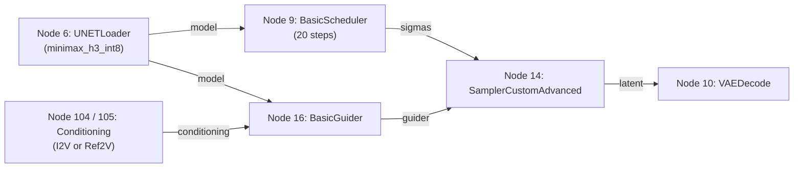
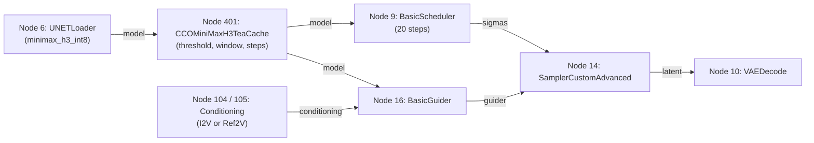
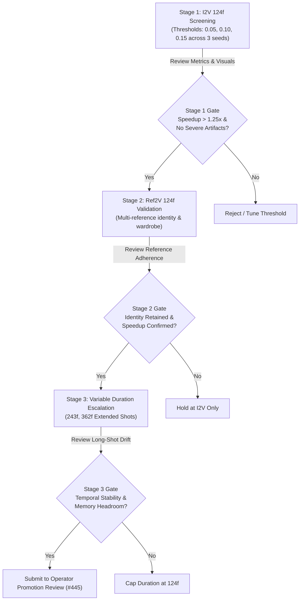

# MiniMax-H3 TeaCache Timestep-Caching Experiments Specification & Operator Runbook

## 1. Purpose, Executive Summary & Non-Production Governance Boundary

This document defines the research, provenance, graph compilation, observation reduction, and candidate evaluation framework for isolated **MiniMax-H3 TeaCache timestep-caching experiments** (Issue #467, child of #421).

### Executive Summary
TeaCache is a training-free inference acceleration approach that computes the relative L1 change of model input embeddings across consecutive sampling timesteps. When the relative difference falls below a calibrated threshold ($\tau$), the model forward pass is skipped and the previous timestep's output velocity/noise prediction is reused. Upstream reports approximately a 3x speedup on a high-VRAM workstation (64GB CMP 170HX) at 1024x576, 124 frames, 20 steps. However, our production target is a 24GB NVIDIA GeForce RTX 4090 operating under dynamic layer offloading at 1344x768 resolution. This specification provides the hardened, strictly isolated engineering framework to evaluate whether TeaCache can reduce sampling latency without unacceptable regressions in visual continuity, subject identity, motion smoothness, or reference adherence.

### Strict Governance Boundary Rules
- **Non-Production Isolation:** This research family is strictly optional, experimental, and disabled by default. It must never alter production render profiles (`MINIMAX_H3_720P_5S_I2V_V1`, `MINIMAX_H3_720P_5S_REF2V_V1`), default ComfyUI launch scripts, or production worker routing.
- **Immutable Canonical Baselines:** Production workflow templates (`templates/minimax_h3_720p_i2v_124f_api.json`, `templates/minimax_h3_720p_ref2v_124f_api.json`), pinned model checkpoints, and the pinned ComfyUI core revision (`55b6a9b11dffecdd65a3ccd5eb6a1b3a178c96dc`) remain strictly immutable.
- **Evidence Paths Never Agent-Authored:** Per repository rules in `AGENTS.md`, directories under `certification/`, `baseline/`, and `config/render-profiles/` contain physical hardware measurements. Automated coding agents must never author synthetic measurements or fabricate hardware speedup certifications.
- **Operator Execution Only:** Physical execution on dedicated NVIDIA RTX 4090 hosts, hardware timing benchmarking, visual quality inspection, and promotion decisions belong exclusively to human operators and operator agents within Issue #445 (or downstream promotion tasks #424–#428).

---

## 2. Pinned Upstream Provenance & Audit Summary

The upstream implementation has been audited, pinned, and adapted with fail-closed safety controls. Detailed audit findings and architectural mitigations are documented in `docs/minimax-h3-teacache-source-audit.md`.

### Source Identification & Manifest
- **Candidate Repository:** `https://github.com/Icyoung/ComfyUI-MiniMaxH3-TeaCache`
- **Pinned Commit:** `4cbb50d69c73a19a5d6ec42c5aec1989d5a04b6f`
- **Upstream License:** MIT License (Copyright (c) 2025 Icyoung)
- **Source Manifest:** `experiments/minimax-h3-teacache/source-manifest.json`
- **Substrate Environment:** CPython 3.12, PyTorch 2.5.1+cu124, CUDA 12.4 (`experiments/minimax-h3-teacache/locks/requirements-teacache-cu124.txt`)

### Upstream Limitations & Hardened In-Tree Architecture
Upstream's implementation exhibits several vulnerabilities that make it unsuitable for unmitigated execution:
1. **Module-Global State Leakage:** Upstream stored session state on the custom node instance across runs, causing cross-job contamination during batch processing, retries, or concurrent queues.
   *Mitigation:* Replaced with Python `contextvars.ContextVar` binding session state strictly to the active task execution context, with defensive reset on lifecycle entry and termination.
2. **In-Place Tensor Mutation:** Upstream cached tensor references without detaching or cloning, risking silent memory corruption across forward passes.
   *Mitigation:* Enforced defensive `.detach().clone()` on all cached latent tensors and intermediate velocities.
3. **Step Count Discrepancies:** Upstream silently allowed mismatches between the node's `total_steps` parameter and the actual scheduler step count.
   *Mitigation:* Preflight parameter validation and runtime sigma matching require that `total_steps` matches `scheduler.steps` exactly (default 20); mismatches raise fail-closed exceptions.
4. **Unverified Compute Skipping:** Upstream lacked instrumentation to verify that skipped forward passes actually bypassed heavy neural network execution.
   *Mitigation:* Dedicated lifecycle hooks and telemetry reduction enforce that zero nested forward passes occur during cache hits; any nested forward pass causes immediate disqualification.
5. **Node Key Isolation:** Hardened implementation exposes `CCOMiniMaxH3TeaCache` with backwards-compatible alias `MiniMaxH3TeaCache`, packaged in `experiments/minimax-h3-teacache/` and isolated from global ComfyUI directories.

---

## 3. Mutual Exclusivity & Single-Factor Controlled Rules

To establish scientific validity and prevent confounding interactions, TeaCache experiments are governed by strict single-factor rules:

### Mutual Exclusivity Gates
1. **No Distillation Combinations:** TeaCache must NOT be combined with distilled checkpoints (e.g. `fastvideo_fasth3_8step_v2`) or Turbo/Lightning LoRAs (e.g. `minimax_h3_fl2v_turbo_8step_v1.0`, `minimax_h3_ref2v_turbo_4step_v0.1`). Distillation modifies the ODE trajectory and step dynamics, invalidating the standard relative L1 difference assumption.
2. **No Accelerated Attention Combinations:** TeaCache must NOT be combined with non-standard attention backends (SageAttention, Veda, Native Sol-Attn) in initial evaluation. It strictly requires the canonical PyTorch SDPA dense backend.
3. **Step Schedule Invariance:** TeaCache must operate on the canonical 20-step schedule (`res_multistep` or `simple`). Step reduction is achieved via timestep caching, not scheduler truncation.
4. **Model Checkpoint Invariance:** Initial experiments require the canonical pinned INT8 ConvRot checkpoint (`minimax_h3_ref2va_pruned_int8_convrot.safetensors` across both I2V and Ref2V routes as defined in canonical production templates).

### Matched Control Invariant Pair
Every TeaCache candidate run (`raw-l1-v1`) must have an exact matched control baseline run (`off` / `matched-control`) executed under identical conditions:
- **Identical Route:** `i2v` (`frame_anchored`) or `ref2v` (`reference_directed`).
- **Identical Resolution & Cadence:** `1344x768` at 24 fps.
- **Identical Frame Count:** 124 frames (5.167s) for initial screening.
- **Identical Random Seed:** Same PRNG seed (e.g. `42`, `101`, `2024`).
- **Identical Prompt & Conditioning:** Exact SHA-256 match of input images, audio tokens, and text prompts.
- **Identical Substrate:** Same host hardware, CUDA driver, PyTorch version, and ComfyUI core revision.

---

## 4. Graph Topologies & Topological Rewiring

The experiment service dynamically derives the experiment workflow graph from canonical templates without mutating on-disk templates.

### Canonical Baseline Topology (Control / Off)
In the canonical unpatched workflow, `UNETLoader` (node 6) connects directly to both `BasicGuider` (node 16) and `BasicScheduler` (node 9):



### TeaCache Patched Topology (`raw-l1-v1`)
In the active TeaCache variant, patch node 401 (`CCOMiniMaxH3TeaCache`) intercepts the model connection from `UNETLoader` (node 6) and supplies the patched model to both `BasicGuider` (node 16) and `BasicScheduler` (node 9):



### Topological Invariants
1. Node 401 connects input `model` to `["6", 0]`.
2. Node 16 connects input `model` to `["401", 0]`.
3. Node 9 connects input `model` to `["401", 0]`.
4. Conditioning connections (nodes 104/105) and VAE decode connections (nodes 10/12/13) remain completely untouched.
5. In unpatched baseline runs, node 401 is omitted entirely; nodes 16 and 9 connect directly to `["6", 0]`.

---

## 5. Parameter Grid & Staged Evaluation Matrix

Experimental evaluation follows a conservative, staged progression to avoid premature escalation and compute waste.

### Candidate Parameter Grid
| Parameter | Conservative Grid Value | Intermediate Grid Value | Upstream Default | Unit / Notes |
| :--- | :--- | :--- | :--- | :--- |
| `rel_l1_thresh` | `0.05` | `0.10` | `0.15` | Relative L1 threshold $\tau$ |
| `start_step` | `2` | `2` | `2` | Initial burn-in steps (no caching) |
| `end_step` | `-2` (step 18) | `-2` (step 18) | `-2` (step 18) | Final refinement steps (no caching) |
| `total_steps` | `20` | `20` | `20` | Must equal scheduler total steps |

*Note: Steps 0 and 1 establish coarse scene structure and must compute full forwards. Steps 18 and 19 resolve fine high-frequency details and must compute full forwards. Caching occurs strictly within steps [2, 17].*

### Staged Progression Matrix


#### Stage 1: I2V 124-Frame Screening (5.167 seconds)
- Focus: Core algorithm verification, hit rate measurement, and baseline artifact assessment.
- Sweep `rel_l1_thresh` at `0.05`, `0.10`, and `0.15`.
- Evaluate across at least 3 distinct seeds (e.g. `42`, `101`, `2024`) to detect seed sensitivity.

#### Stage 2: Ref2V 124-Frame Validation (5.167 seconds)
- Focus: Reference conditioning stability with multi-picture prompt tags.
- Verify whether skipping forward passes impairs character identity retention or reference wardrobe binding.

#### Stage 3: Variable Duration Escalation (Conditional)
- Only if Stage 1 and Stage 2 show acceptable visual quality:
  - **243 frames (~10.125s):** Test long-term motion and identity consistency.
  - **362 frames (~15.083s):** Test extreme shot duration and GPU VRAM offload stability.

---

## 6. RTX 4090 Hardware Profile & Dynamic Offloading Dynamics

Inference execution on 24GB RTX 4090 involves distinct hardware behaviors that contrast with upstream's high-VRAM workstation setup:

1. **Layer Offloading vs Compute:**
   MiniMax-H3's large INT8 DiT requires dynamic CPU offloading to fit in 24GB VRAM alongside the 32B multimodal text encoder and VAEs. During normal execution, weights stream across the PCIe bus for every model forward pass.
2. **PCIe Savings from Timestep Skipping:**
   When TeaCache hits and skips a forward pass, it avoids not only CUDA kernel execution but also the PCIe bus transmission of model layers for that step. This can provide meaningful latency reduction even with dynamic offload overhead.
3. **Host RAM Buffers:**
   Cached latent tensors must be pinned in system memory or GPU VRAM. Ensure system host RAM remains below the 64GB safety ceiling to prevent OS swap thrashing.
4. **VRAM Safety Margin:**
   Peak VRAM must remain under 23,500 MiB (giving a 500 MiB safety buffer before the 24,576 MiB hardware ceiling).

---

## 7. Fail-Closed Telemetry, Accounting & Fallback Detection

The TeaCache experiment reducer (`minimax-h3-teacache-reducer.ts`) and comparator (`minimax-h3-comparator.ts`) enforce strict telemetry integrity:

### Telemetry Invariant Checks
1. **Cache Hit Accounting:**
   - Every sampling step records whether it executed a full forward pass (`full`) or skipped execution via cache (`skip`).
   - $\text{Total Steps} = \text{Forward Calls} + \text{Cache Hits}$.
2. **Zero Nested Forward Passes:**
   - During a cache hit, the underlying model must NOT execute any internal forward passes. Nested forward calls on cache hits must be strictly 0.
   - Any nested forward pass indicates wrapper leak and causes immediate evaluation failure.
3. **No-Op Detection:**
   - If a candidate run yields 0 cache hits ($\text{hits} = 0$), status is classified as `no_op`.
   - `no_op` runs are disqualified from claiming speedup metrics (`samplingWallEligible = false`, `metrics = null`).
4. **Zero Fallback Tolerance:**
   - Any runtime error or fallback to dense computation without caching is captured as an execution failure.
5. **No Synthetic Metrics:**
   - Timing ratios and speedup metrics are calculated strictly from measured wall time in milliseconds (`variant / baseline`).

---

## 8. Step-by-Step Operator Runbook

This section details the exact CLI commands and operational workflow for operators executing TeaCache experiments on RTX 4090 render hosts.

### Step 1: Environment Preparation, Isolated Checkout/Venv & Substrate Check
Verify CUDA driver, isolated ComfyUI checkout at pinned core revision, isolated Python virtual environment, read-only model weight checksums, and hash-verified adapter staging:
```bash
# Set once, from inside your comfy-content-orchestrator checkout. Every
# command below is written with an explicit path or explicit --cd so none
# of them depend on your shell's current directory -- `cd` into the
# isolated ComfyUI checkout happens exactly once, for the git checkout
# step, and is immediately followed by `cd -` back.
CCO_REPO_ROOT="$(pwd)"
COMFYUI_ISOLATED_DIR=/opt/comfyui-isolated-teacache

# Verify GPU visibility and driver
nvidia-smi --query-gpu=name,driver_version,memory.total --format=csv,noheader

# 1. Prepare dedicated isolated ComfyUI checkout (never mutate production or global /opt/comfyui)
git clone https://github.com/Comfy-Org/ComfyUI.git "$COMFYUI_ISOLATED_DIR"
(cd "$COMFYUI_ISOLATED_DIR" && git checkout 55b6a9b11dffecdd65a3ccd5eb6a1b3a178c96dc)
"$CCO_REPO_ROOT/scripts/check-comfyui-version.sh" --comfy-dir "$COMFYUI_ISOLATED_DIR"

# 2. Setup isolated virtualenv and install pinned experiment requirements.
# --extra-index-url is required: the pinned +cu124 wheels are not on the
# default PyPI index. Also install ComfyUI's own base requirements, which
# the TeaCache lockfile intentionally does not duplicate.
python3 -m venv "$COMFYUI_ISOLATED_DIR/.venv"
source "$COMFYUI_ISOLATED_DIR/.venv/bin/activate"
pip install --extra-index-url https://download.pytorch.org/whl/cu124 \
  -r "$CCO_REPO_ROOT/experiments/minimax-h3-teacache/locks/requirements-teacache-cu124.txt"
pip install -r "$COMFYUI_ISOLATED_DIR/requirements.txt"
python3 --version  # Must be 3.11.x or 3.12.x
pip list | grep -E "torch|comfy"

# 2b. Link (never copy) the existing read-only MiniMax-H3 model weights into
# the isolated checkout's models directory. $EXISTING_MODELS_ROOT is
# whatever host path already holds the certified, checksum-verified
# weights for your production ComfyUI install -- do not download or
# re-derive them here.
mkdir -p "$COMFYUI_ISOLATED_DIR/models/diffusion_models" \
  "$COMFYUI_ISOLATED_DIR/models/text_encoders" \
  "$COMFYUI_ISOLATED_DIR/models/vae"
ln -s "$EXISTING_MODELS_ROOT/diffusion_models/"* "$COMFYUI_ISOLATED_DIR/models/diffusion_models/"
ln -s "$EXISTING_MODELS_ROOT/text_encoders/"* "$COMFYUI_ISOLATED_DIR/models/text_encoders/"
ln -s "$EXISTING_MODELS_ROOT/vae/"* "$COMFYUI_ISOLATED_DIR/models/vae/"

# 3. Verify MiniMax-H3 weights exist, are mounted read-only, and match pinned SHA-256
"$CCO_REPO_ROOT/scripts/check-minimax-h3-version.sh" --comfy-dir "$COMFYUI_ISOLATED_DIR"

# 4. Stage hardened TeaCache custom node into isolated custom_nodes directory and verify file hashes
mkdir -p "$COMFYUI_ISOLATED_DIR/custom_nodes/cco-minimax-h3-teacache/locks"
cp "$CCO_REPO_ROOT/experiments/minimax-h3-teacache/locks/requirements-teacache-cu124.txt" \
   "$COMFYUI_ISOLATED_DIR/custom_nodes/cco-minimax-h3-teacache/locks/"
cp "$CCO_REPO_ROOT/experiments/minimax-h3-teacache/__init__.py" \
   "$CCO_REPO_ROOT/experiments/minimax-h3-teacache/nodes.py" \
   "$CCO_REPO_ROOT/experiments/minimax-h3-teacache/teacache.py" \
   "$COMFYUI_ISOLATED_DIR/custom_nodes/cco-minimax-h3-teacache/"

# Verify staged file SHA-256 matches pinned in-tree adapter file hashes
sha256sum "$COMFYUI_ISOLATED_DIR/custom_nodes/cco-minimax-h3-teacache/"*
```

Adapter resolution is strictly scoped to the target ComfyUI `custom_nodes/` directory:
there is no repository-relative, cwd-relative, or hardcoded-path fallback, and a symlinked
package pointing outside `custom_nodes/` is rejected (stage by copying). Pre-submit, the
capability handshake must report a verified `teacacheAdapterIdentity` whose digest matches
the request, all three adapter files' hashes, the node's `INPUT_TYPES()` signature hash, the
pinned core source hashes (commit `55b6a9b`: H3 nodes, model_patcher, samplers, model_base,
custom sampler, sampler_helpers, minimax model) and the staged dependency-lock hash. A
locally patched core checkout will be blocked. Candidate and matched-control runs share
every check.

### Step 2: Catalog Inspection
Verify that TeaCache entries are recognized in the experiment catalog:
```bash
pnpm experiment:minimax-h3 catalog --teacache
```
Expected output: Catalog listing displaying `teacache-raw-l1-i2v`, `teacache-raw-l1-ref2v`, and matched controls.

### Step 3: Prepare Matched Baseline Control Run
Generate the unpatched baseline experiment descriptor using dedicated loopback port 8199 and isolated ComfyUI:
```bash
pnpm experiment:minimax-h3 prepare \
  --route i2v \
  --frames 124 \
  --seed 42 \
  --inputs manifest-i2v.json \
  --prompt "A cinematic shot of a person smiling warmly, natural lighting" \
  --target-host render-worker-01 \
  --gpu-uuid GPU-12345678-1234-1234-1234-123456789abc \
  --comfyui-dir /opt/comfyui-isolated-teacache \
  --python /opt/comfyui-isolated-teacache/.venv/bin/python3 \
  --port 8199 \
  --run-id baseline-i2v-s42 \
  --output-root .ai-runs/minimax-h3-experiments \
  --teacache-matched-control
```

### Step 4: Prepare TeaCache Candidate Run
Generate the patched TeaCache experiment descriptor with required explicit knobs:
```bash
pnpm experiment:minimax-h3 prepare \
  --route i2v \
  --frames 124 \
  --seed 42 \
  --inputs manifest-i2v.json \
  --prompt "A cinematic shot of a person smiling warmly, natural lighting" \
  --target-host render-worker-01 \
  --gpu-uuid GPU-12345678-1234-1234-1234-123456789abc \
  --comfyui-dir /opt/comfyui-isolated-teacache \
  --python /opt/comfyui-isolated-teacache/.venv/bin/python3 \
  --port 8199 \
  --run-id candidate-i2v-t10-s42 \
  --output-root .ai-runs/minimax-h3-experiments \
  --teacache raw-l1-v1 \
  --teacache-threshold 0.10 \
  --teacache-start-step 2 \
  --teacache-end-step -2 \
  --teacache-total-steps 20
```

### Step 5: Offline Semantic Validation
Validate both descriptors against graph topology and runtime invariants:
```bash
# Validate baseline control
pnpm experiment:minimax-h3 validate \
  --run-dir .ai-runs/minimax-h3-experiments/baseline-i2v-s42 \
  --output-root .ai-runs/minimax-h3-experiments

# Validate candidate variant
pnpm experiment:minimax-h3 validate \
  --run-dir .ai-runs/minimax-h3-experiments/candidate-i2v-t10-s42 \
  --output-root .ai-runs/minimax-h3-experiments
```

### Step 6: Physical Execution (Operator on RTX 4090)
Execute both runs sequentially under clean system conditions (restarting background services if necessary to clear VRAM fragmentation).
A stop-policy JSON file (e.g. `/opt/comfyui-isolated-teacache/operator-stop-policy.json`) is strictly required when executing `run`.

**Fail-closed catalog admission prerequisite:** `experiments/minimax-h3-teacache/catalog.json` pins every candidate's
`compatibilityState` to `"unverified"` and `runnable` to `false` until this issue's TeaCache variant has been through
#445's real-hardware operator benchmark (per the epic #421 roadmap's release invariant). `run` will refuse to execute
an entry whose catalog record is not marked runnable; this is intentional and is not a bug to work around -- it is
the gate that keeps an offline-prepared candidate from being promoted to a real GPU run without that explicit sign-off.

```bash
# Define operator-authored stop policy
cat << 'EOF' > /opt/comfyui-isolated-teacache/operator-stop-policy.json
{
  "policyId": "rtx-4090-minimax-h3-default-stop-v1",
  "maxPeakVramMb": 24000,
  "maxHostRamMb": 60000,
  "maxSwapUsedMb": 4096,
  "maxSwapDeltaMb": 2048,
  "maxExecutionDurationMs": 1200000,
  "requireCompleteTelemetry": true,
  "requireConformantProbe": true,
  "visualStopConditions": [
    "severe_flicker_or_tearing",
    "subject_identity_collapse",
    "extreme_motion_blur_or_distortion"
  ]
}
EOF

# Execute baseline control
pnpm experiment:minimax-h3 run \
  --run-dir .ai-runs/minimax-h3-experiments/baseline-i2v-s42 \
  --output-root .ai-runs/minimax-h3-experiments \
  --stop-policy /opt/comfyui-isolated-teacache/operator-stop-policy.json

# Execute candidate variant
pnpm experiment:minimax-h3 run \
  --run-dir .ai-runs/minimax-h3-experiments/candidate-i2v-t10-s42 \
  --output-root .ai-runs/minimax-h3-experiments \
  --stop-policy /opt/comfyui-isolated-teacache/operator-stop-policy.json
```

### Step 7: Telemetry Reconciliation
Reduce raw execution events into structured observation facts:
```bash
# Reconcile baseline
pnpm experiment:minimax-h3 reconcile \
  --run-dir .ai-runs/minimax-h3-experiments/baseline-i2v-s42 \
  --output-root .ai-runs/minimax-h3-experiments

# Reconcile candidate
pnpm experiment:minimax-h3 reconcile \
  --run-dir .ai-runs/minimax-h3-experiments/candidate-i2v-t10-s42 \
  --output-root .ai-runs/minimax-h3-experiments
```

### Step 8: Comparative Evaluation
Run the automated invariant and metric comparator:
```bash
pnpm experiment:minimax-h3 compare \
  --baseline .ai-runs/minimax-h3-experiments/baseline-i2v-s42 \
  --variant .ai-runs/minimax-h3-experiments/candidate-i2v-t10-s42 \
  --output-root .ai-runs/minimax-h3-experiments
```

### Step 9: Probed Video Asset Verification
Verify output media container and streams via `ffprobe`:
```bash
ffprobe -v error -select_streams v:0 \
  -show_entries stream=width,height,r_frame_rate,nb_frames,codec_name \
  -of json .ai-runs/minimax-h3-experiments/candidate-i2v-t10-s42/output.mp4

# Verify audio stream presence and synchronization
ffprobe -v error -select_streams a:0 \
  -show_entries stream=codec_name,sample_rate,channels \
  -of json .ai-runs/minimax-h3-experiments/candidate-i2v-t10-s42/output.mp4
```

### Step 10: Operator Decision Sidecar Import
Validate and import the human continuity and quality review sidecar:
```bash
# Validate sidecar schema and criteria
pnpm experiment:minimax-h3 validate-sidecar \
  --sidecar .ai-runs/minimax-h3-experiments/candidate-i2v-t10-s42/operator-decision.json \
  --run-dir .ai-runs/minimax-h3-experiments/candidate-i2v-t10-s42

# Import approved sidecar into result.json
pnpm experiment:minimax-h3 import-sidecar \
  --sidecar .ai-runs/minimax-h3-experiments/candidate-i2v-t10-s42/operator-decision.json \
  --run-dir .ai-runs/minimax-h3-experiments/candidate-i2v-t10-s42
```

### Step 11: Workspace Cleanup & Evidence Retention
Preserve all durable evidence while cleaning up owned child processes and ephemeral staging directories:
```bash
# 1. Retain all durable execution evidence (descriptors, results, events.jsonl, capability handshakes, output videos, sidecars):
pnpm experiment:minimax-h3 cleanup \
  --run-dir .ai-runs/minimax-h3-experiments/candidate-i2v-t10-s42

# Optional: To remove heavy raw output video while preserving result.json, events.jsonl, and logs:
# pnpm experiment:minimax-h3 cleanup --run-dir .ai-runs/minimax-h3-experiments/candidate-i2v-t10-s42 --remove-outputs

# 2. Owned teardown: clean up isolated staged custom node files and deactivate isolated virtualenv
rm -rf /opt/comfyui-isolated-teacache/custom_nodes/cco-minimax-h3-teacache
deactivate
```

---

## 9. Qualitative Visual Evaluation Rubric & Creative Regressions

TeaCache introduces specific temporal approximation artifacts that cannot be assessed through loss functions alone. Operators must inspect full-motion video playback on calibrated monitors across seven evaluation dimensions:

### 1. Subject Identity & Facial Coherence
- **Check:** Does the subject's face maintain bone structure, eye shape, and skin tone across timesteps?
- **Failure Mode:** Facial morphing, features drifting toward a generic average, or micro-expression freezing.

### 2. Wardrobe & Fine Fabric Textures
- **Check:** Are fabric weaves, garment seams, embroidery, and small accessories sharp and continuous?
- **Failure Mode:** Texture smoothing, sudden blotchiness, or geometric flattening of intricate clothing patterns.

### 3. Scene Background Continuity & Spatial Stability
- **Check:** Do background architecture, trees, horizon lines, and furniture remain spatially locked?
- **Failure Mode:** Background swimming, phantom objects appearing/disappearing, or scene replacement.

### 4. Motion Smoothness & Trajectory Jerk
- **Check:** Is character and camera motion continuous and natural throughout the 5+ second shot?
- **Failure Mode:** Sudden acceleration/deceleration shudder when switching between cached and computed steps.

### 5. Temporal Flicker & High-Frequency Shimmer
- **Check:** Is there persistent luminance flicker or high-frequency pixel crawling across consecutive frames?
- **Failure Mode:** Aliasing shimmer on sharp contrast edges and hair strands.

### 6. Reference Adherence (Ref2V Route Only)
- **Check:** Does the generated character match the reference image manifest in clothing, hairstyle, and lighting?
- **Failure Mode:** Reference conditioning decoupling where the model ignores picture prompts during skipped steps.

### 7. Audio / Video Synchronization & Playback Integrity
- **Check:** Does speech or sound remain strictly in sync with on-screen character motion and visual events without temporal drift?
- **Failure Mode:** Audio latency offset, popping, crackling, or dropped samples during skipped compute intervals.

---

## 10. Safe Abort Triggers & Formal GO/NO-GO Criteria

### Safe Abort Triggers
The operator must terminate execution immediately if any of the following triggers occur:
1. **GPU Memory Overrun:** VRAM consumption exceeds 23,500 MiB or triggers a CUDA Out-Of-Memory (OOM) exception.
2. **Host RAM Exhaustion:** System RAM exceeds 60,000 MiB or swap activity begins (`vmstat 1` swap-in > 0).
3. **Nested Forward Calls:** Reconciled telemetry indicates `nestedForwardCallsRecorded > 0`.
4. **Catastrophic Quality Collapse:** Severe visual tearing, black frames, or complete scene replacement.
5. **No-Op Execution:** Cache hits recorded is 0 after completing the sampling loop.

### Formal GO/NO-GO Gate Decision
| Evaluation Criterion | Mandatory Requirement | Threshold for "GO" |
| :--- | :--- | :--- |
| **End-to-End Latency Speedup** | Sampling wall-time ratio variant/baseline $< 0.85$ | $\ge 15\%$ sampling wall time reduction ($\le 0.85\times$) |
| **Cache Hit Efficiency** | Cache hits $\ge 3$ out of 20 steps ($\ge 15\%$) | $30\% - 50\%$ cache hits ($6-10$ steps skipped) |
| **Resource Envelope** | Peak VRAM $\le 23,500\text{ MiB}$, Peak RAM $\le 60\text{ GiB}$ | Fully compliant with zero swap thrashing |
| **Visual Quality Score** | No severe defects across identity, scene, motion | Rated "Pass" or "Acceptable Minor Drift" across all seeds |
| **Reference Fidelity** | Ref2V conditioning retains character binding | 100% adherence to staged reference images |
| **AV Sync & Audio Quality** | Audio in sync, zero audio pop/dropout | Verified full audio playback continuity |
| **Legal & Licensing Sign-off** | MIT License compliance verified | Upstream copyright and MIT license attributed |
| **Evidence Retention** | Complete run directory committed | Durable retention of `.ai-runs/`, events, and configs |

- **GO Decision:** All mandatory requirements met across all 3 seeds at candidate threshold. Operator signs evaluation report and submits to #445 for integration consideration.
- **NO-GO Decision:** Excessive visual artifacts, speedup below $15\%$, or stability failures. The candidate variant remains isolated in the research catalog and is NOT approved for profile promotion.
